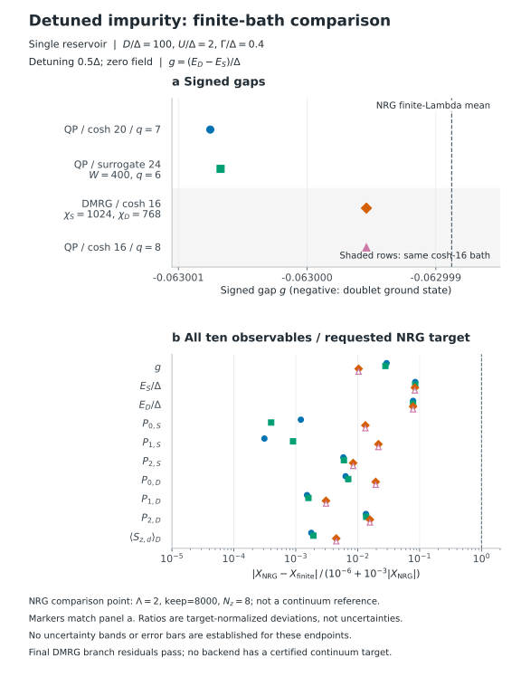
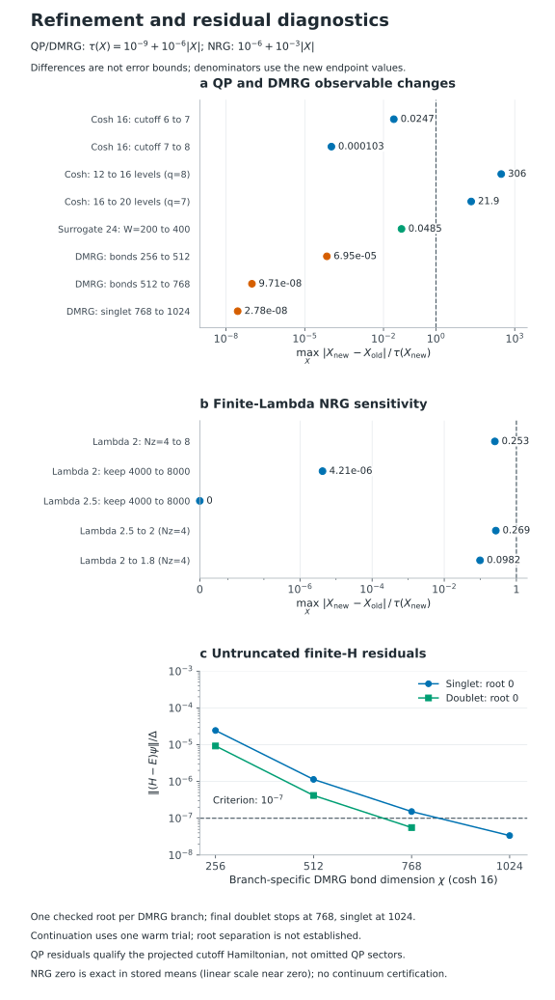

# Detuned Superconducting Impurity: Final Results

## TL;DR

- **Doublet ground state:** the signed singlet-doublet gap is approximately
  $-0.063001\Delta$ in the larger-bath QP calculations.
- **DMRG versus QP:** on the identical 16-level bath, the branch energies agree
  within $2.0\times10^{-14}\Delta$ and the gap within $2.7\times10^{-14}\Delta$.
  Both final DMRG branches pass the prescribed $10^{-7}\Delta$ residual check.
- **QP versus NRG:** all ten reported observables at the four final finite-bath
  endpoints differ from the selected NRG point by less than 0.086 of the
  corresponding requested NRG tolerance. This is **not** an uncertainty bound.
- **Accuracy:** the finite-problem comparison is complete, but bath refinement
  still changes some QP observables beyond their requested tolerance. NRG results
  are finite-$\Lambda$ twist means, not continuum extrapolations. No backend has
  established the requested continuum accuracy for this detuned model.

This is the zero-field, detuned single-reservoir step after Test1's
particle-hole-symmetric model. Test3 adds a local field; Test4 adds two leads
and a phase difference.

## Model

One superconducting reservoir with gap $\Delta=1$, normal-state **half-bandwidth**
$D=100\Delta$, interaction $U=2\Delta$, total hybridization $\Gamma=0.4\Delta$,
detuning $\epsilon=\epsilon_d+U/2=0.5\Delta$, and zero field. Thus the conventional
Anderson level is $\epsilon_d=-0.5\Delta$. The impurity Hamiltonian is

```math
H_d=\frac{U}{2}(n_d-1)^2+\epsilon(n_d-1).
```

Reported energies subtract the disconnected BCS vacuum of the corresponding
bath. NRG energies are mapped to the same impurity reference, including the
detuning shift. The signed gap is $g=(E_D-E_S)/\Delta$; negative values mean the
doublet is lower. See the shared [model conventions](../../docs/models.md).

Bath sizes count signed normal levels. Here $q$ is the QP cutoff, $\chi$ the DMRG
bond dimension, and $W$ the surrogate fitting-window upper limit in units of
$\Delta$. Changing $W$ does **not** change physical $D$. Explicit bath weights
are not renormalized, and dark modes are not removed (`compress=False`). Unlike
[test1](../test1/README.md), this calculation is not particle-hole symmetric:
$P_0$ and $P_2$ need not agree.

## Energies and Gap

| Method | Bath and numerical setting | $E_S/\Delta$ | $E_D/\Delta$ | $g$ |
|---|---|---:|---:|---:|
| NRG | $\Lambda=2$, 8 twists, keep=8000 | -1.0225484532 | -1.0855473296 | -0.0629988764 |
| QP | Cosh 20, $q=7$ | -1.0224613837 | -1.0854621359 | -0.0630007522 |
| QP | Surrogate 24, $W=400$, $q=6$ | -1.0224614563 | -1.0854621282 | -0.0630006719 |
| DMRG | Cosh 16, $\chi_S=1024$, $\chi_D=768$ | -1.0224626022 | -1.0854621415 | -0.0629995393 |
| QP | Same cosh 16, $q=8$ | -1.0224626022 | -1.0854621415 | -0.0629995393 |

Displayed digits are rounded stored values, not claims of achieved continuum
precision. The two larger-bath QP gaps differ by $8.03\times10^{-8}\Delta$.
The cosh-16 QP gap differs from the displayed NRG mean by
$6.63\times10^{-7}\Delta$; the cosh-20 gap differs by
$1.88\times10^{-6}\Delta$. Closer agreement of the smaller bath with one NRG
point is not proof that its bath discretization is more accurate.



The two shaded cosh-16 points use the **same finite Hamiltonian**. The NRG line
is a selected finite-$\Lambda$ comparison point, not a continuum reference or
an uncertainty band. Ratios in the figure divide by the requested NRG target,
not by an estimated numerical error. Test1's NRG error estimates are not
transferred to this different physical model.

## Probabilities and Moment

$P_0$, $P_1$, and $P_2$ are the impurity empty, singly occupied, and doubly occupied
probabilities. $P_1$ includes both spins. The dimensionless impurity moment
$m_D=\langle S_d^z\rangle$ is evaluated in the total spin-up doublet; a free
spin-up impurity electron has $m_D=1/2$.

| Quantity | NRG, $\Lambda=2$, 8 twists | QP cosh 20 | QP surrogate 24 | DMRG cosh 16 |
|---|---:|---:|---:|---:|
| Singlet $P_0$ | 0.5408695465 | 0.5408702014 | 0.5408697636 | 0.5408623353 |
| Singlet $P_1$ | 0.3681995582 | 0.3681994431 | 0.3681998917 | 0.3682075467 |
| Singlet $P_2$ | 0.0909308952 | 0.0909303554 | 0.0909303448 | 0.0909301180 |
| Doublet $P_0$ | 0.0918736948 | 0.0918731028 | 0.0918730407 | 0.0918718797 |
| Doublet $P_1$ | 0.8566997853 | 0.8567010893 | 0.8567011587 | 0.8567024265 |
| Doublet $P_2$ | 0.0514265199 | 0.0514258079 | 0.0514258005 | 0.0514256938 |
| Doublet $m_D$ | 0.4207320291 | 0.4207327804 | 0.4207328406 | 0.4207339289 |

The same-bath cosh-16 QP probabilities agree with final DMRG within
$1.8\times10^{-13}$. Every probability triple normalizes to one within numerical
roundoff. Positive detuning favors an empty over a doubly occupied impurity.
The singlet moment is a symmetry-zero diagnostic, retained separately from the
ten nonzero accuracy targets.

## Achieved Accuracy

The requested observable tolerance is $10^{-9}+10^{-6}\lvert X\rvert$ for QP/DMRG
and $10^{-6}+10^{-3}\lvert X\rvert$ for NRG. Comparisons below use the **new**
endpoint's value and backend in the denominator. Small differences are empirical
stability evidence, not error bounds or a certification of these targets.

The final same-bath QP/DMRG comparison passes the finite-problem criteria.
Unresolved bath dependence and limited NRG twist/discretization checks prevent
a stronger continuum-accuracy claim. Detailed refinement and residual evidence
is in [Supplemental material](#supplemental-material).

## Data and Provenance

- [Results JSON](output/results.json): all 14 finite endpoints, seven NRG twist
  means, definitions, residuals, qualification flags, and 18 comparisons.
- [Observable table](output/observables.csv): 210 rows retaining the full stored
  precision and branch-specific DMRG bond dimensions.
- [Comparison table](output/comparisons.csv): 180 rows with both operands,
  signed differences, normalization scales, and explicit denominator meanings.
- [Physical inputs](input/physical.json) and [explicit baths](input/baths.json):
  model, targets, nodes, and original unnormalized weights.
- [Provenance](reference/provenance.json): software versions, relative source
  identifiers/hashes, result verification and branch origins. Recorded original
  hashes and current public-file hashes are separate; private installation and
  session metadata are not included.

This directory is a self-contained publication, not a copy of that archive.
Reading results or regenerating tables/figures requires no historical run
directories, NRG installation, Mathematica license, HDF5 files, or MPS checkpoints.
Presentation regeneration does not reproduce the numerical calculation. A
separate [standalone manual NRG workflow](manual_run/README.md) prepares a fresh
single-$\Lambda$ z sweep in numbered directories and computes all ten report
observables. Its default is the reported $\Lambda=2$, eight-twist, `keep=8000`
point; raw calculations are not included in the publication bundle.

## Reproduction

[generate.py](generate.py) reads the published JSON and recreates both CSVs and
SVG figures without running solvers. With Matplotlib installed, run from the
repository root:

```sh
python -B NRG_comparisons/test2/generate.py --png
```

The generated files and optional PNG previews go to ignored `runs/presentation/`
inside this case, or to `--output-dir PATH`. The script refuses to overwrite
the published `output/`, including symlink aliases. For a standard-library-only
table regeneration and validation:

```sh
python -B -S NRG_comparisons/test2/generate.py --tables-only
```

The generator validates physical identities, stored comparison operands,
qualification flags, and generated tables. Figures carry their numerical plotting
data in SVG metadata. Captions describe these reviewed results, not arbitrary
fresh calculations.

## Supplemental material

### Refinement Checks

| Refinement | Largest absolute change / requested tolerance | Interpretation |
|---|---:|---|
| Cosh 16, QP cutoff 6 to 7 | 0.0247 | Stable cutoff step on this bath |
| Cosh 16, QP cutoff 7 to 8 | 0.000103 | Further cutoff stability |
| Cosh 12 to 16, $q=8$ | 306 | Bath changes exceed targets |
| Cosh 16 to 20, $q=7$ | 21.9 | Bath changes still exceed targets |
| Surrogate 24, $W=200$ to 400, $q=6$ | 0.0485 | One stable window step |
| DMRG, bonds 256 to 512 | 6.95e-5 | Values stable, but both residuals still fail |
| DMRG, bonds 512 to 768 | 9.71e-8 | Doublet residual passes; singlet does not |
| DMRG, singlet bond 768 to 1024 | 2.78e-8 | Both final branches now pass |
| NRG, $\Lambda=2$, 4 to 8 twists | 0.253 | Finite-twist sensitivity |
| NRG, $\Lambda=2$, keep 4000 to 8000, 8 twists | 4.21e-6 | Small retention sensitivity |
| NRG, $\Lambda=2.5$, keep 4000 to 8000, 4 twists | 0 | Identical stored means, not a general error bound |
| NRG, $\Lambda=2.5$ to 2, 4 twists | 0.269 | Finite-discretization sensitivity |
| NRG, $\Lambda=2$ to 1.8, 4 twists | 0.0982 | Finite-discretization sensitivity |



### Residuals

The DMRG residuals are evaluated by untruncated application of the finite
Hamiltonian, not by subtracting two large energy moments. They are divided by
$\Delta$ below; the acceptance threshold remains $10^{-7}$.

| Bond dimension | Singlet root 0 | Doublet root 0 |
|---|---:|---:|
| 256 | 2.432e-5 | 9.228e-6 |
| 512 | 1.137e-6 | 4.168e-7 |
| 768 | 1.519e-7 | 5.577e-8 |
| 1024 | 3.375e-8 | Not needed; final doublet remains at 768 |

Only the lowest root in each DMRG sector is targeted. Earlier three-trial
calculations support state selection; higher-bond refinements use one warm trial
and do **not** constitute new independent-seed tests. One-root results do not
certify root separation or exclude an unresolved degeneracy. The QP residuals
refer to the projected cutoff Hamiltonians and do not bound the omitted QP
sectors. See [numerical diagnostics](../../docs/numerics.md#residuals-and-convergence-checks).

### Controls and Limitations

The finite-control discrepancies and the unchanged absolute $10^{-8}$ bound
are retained in the results JSON. Passing these controls does not establish
continuum convergence.

An NRG flow finished numerically but failed during result registration. Its
raw data were recovered without rerunning the flow; recovery is not represented
as a successful original worker exit. A timed-out DMRG calculation's completed
$\chi=512$ singlet was retained, and the doublet was continued separately.
Subsequent accepted refinements provide the final states. The provenance retains
these scientific qualifications without the private execution history.
