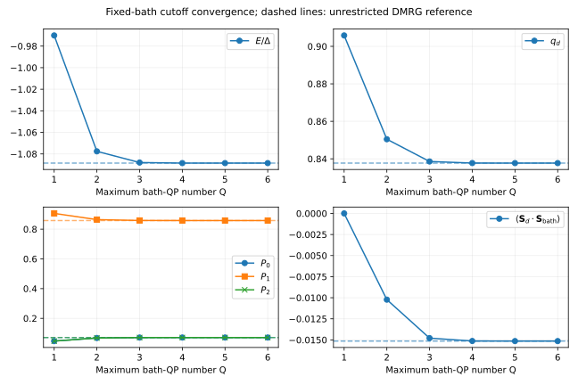

# QP calculations and observable-specific convergence

The QP expansion retains every impurity configuration but restricts the total
number of bath quasiparticles. Increasing the cutoff enlarges a variational
space for the **same finite Hamiltonian**, keeping the bath fixed. Diagonalization
optimizes all amplitudes within the retained space, including repeated tunnelling processes.

## Estimate the basis dimension before allocating memory

```python
from qdjj_solver import Sector, cosh_grid, reference_model, solve
from qdjj_solver.qp_solver import dimension

h = reference_model(cosh_grid(pairs=1, bandwidth=5.), u=1.6,
                    gamma=.3, phi=.8, symmetry=False, compress=False)
sector = Sector(1, 1)
for q in [1, 2, 3, 4, h.bath_modes]:
    print(q, dimension(h.nimp, h.spins, q, sector, h.eta_labels))
```

`dimension` counts basis states without explicitly constructing them. It takes an integer cutoff;
use `h.bath_modes` for the full finite-space count. A solver call instead accepts
`cutoff=None` as the full-space shorthand. Counts grow combinatorially with
bath size and cutoff, so start with a deliberately small case.

The automatic eigensolver chooses dense, sparse or matrix-free operation based
on dimension. Matrix-free operation reduces matrix storage but still needs a
basis, iterative vectors and workspace for applying operators. `max_memory_gib` limits
estimated basis and matrix storage; allow additional memory for the running process. The
[option reference](reference/options.md#qp-solver) lists thresholds and controls.

## Refine the cutoff at fixed bath

```python
import numpy as np

exact = solve(h, cutoff=None, sector=sector)
for q in [1, 2, 3, 4]:
    state = solve(h, cutoff=q, sector=sector)
    print(q, state.energies[0], state.residuals[0],
          state.observables["impurity_spin_z"][0], state.qp_weights[0, -1])
    assert state.energies[0] >= exact.energies[0] - 1e-10
```

For nested spaces and an accurately solved ground state of one sector, the
energy approaches the finite-space value from above. Differences between two
sector energies can approach their converged values from either side. A parity-transition
location can therefore move even when both absolute energies look stable.

The projected residual measures eigensolver accuracy for $P_q H P_q$.
Comparing successive cutoffs measures the effect of including additional QP
configurations in the variational space.

## Reuse preparation and check spectrum coverage

`QPWorkspace` reuses compatible bases, projected operators and matrices within
a memory budget. Dense calculations can reuse the complete eigensystem when
the requested number of states or measured observables changes:

```python
from qdjj_solver.qp_solver import ExecutionContext, QPWorkspace, SolverOptions

workspace = QPWorkspace(max_memory_gib=0.1)
options = SolverOptions(method="dense", eigenpairs=2)
events = []
prepared = workspace.solve(h, cutoff=2, sector=sector, options=options,
                           context=ExecutionContext(progress=events.append))
reused = workspace.solve(h, cutoff=2, sector=sector, options=options,
                         observables=["impurity_spin_z"])
np.testing.assert_allclose(reused.energies, prepared.energies, rtol=0, atol=1e-12)
assert reused.metadata["reuse"]["eigensystem"]
assert not prepared.vectors.flags.writeable

edge = float((prepared.energies[0] + prepared.energies[1])/2)
count = workspace.count_below(h, 2, sector, edge, margin=1e-8)
print(count)  # below/through count states at the two boundaries edge +/- margin
assert count["status"] == "checked" and count["below"] == count["through"] == 1
workspace.clear()
```

Returned numerical arrays are read-only snapshots. Clearing the workspace
releases its caches; retained results remain valid and count towards its live
memory. A coefficient change can reuse the enumeration, while automatic starting
vectors require matching physical coordinates, cutoff and sector. The
`sparse`, `matrix-free` and `block` methods use these starting states when
explicitly selected. They retain the same residual checks as fresh solves.

`ExecutionContext` reports stages and elapsed seconds. A `cancelled` callback
can request `CalculationCancelled` at a checkpoint; native QP loops also check
Python signals. Completed results remain usable after cancellation.

State counts use the complete cached dense spectrum when available. Otherwise,
for dimensions within `count_limit` and the memory budget, an independent
Hermitian LDL factorization checks the two energy boundaries. Inspect `status`:
`"unavailable"` means a resource or preparation limit, and `"unresolved"` means
the boundary count could not be validated. A checked count concerns this finite
bath and QP cutoff; it does not determine continuum accuracy.

## Decide which accuracy matters

Choose a tolerance for the reported quantity before claiming convergence. For
an excitation, compare excitation differences; for a current, compare the
phase derivative; for a correlation, compare the correlation itself. Assess
wavefunction and observable accuracy through their own convergence checks.

The [observable-convergence study](qp_convergence.md) provides a useful example:



That study uses a different junction from the installation example: interaction
two, total hybridization 0.4, half-bandwidth 100 and phase $3\pi/5$, in a selected
odd eta sector with dark modes frozen. Its full report specifies finite-bath
and MPS checks. At two QPs the local-spin discrepancy is about 1.52%, while the
dot–bath spin-correlation magnitude differs by about 32.46%. Those are properties
of that recorded case; determine the cutoff error for each new parameter regime.

The probability at the QP cutoff is a useful diagnostic of the state composition.
Observable-error estimates require explicit refinement: enlarging the space changes
amplitudes already retained, and observables can connect QP sectors through coherent
matrix elements. Store the distribution alongside the refinement results.

## Recognize numerical rather than truncation failures

- Increase `ncv` or `maxiter` to converge the iterative solver before assessing
  the QP-cutoff error.
- At exact degeneracy, a single-vector iteration can miss repeated eigenvalues.
  Resolve symmetries or compare the complete subspace with a small dense reference calculation.
- For an empty or incompatible sector, check the model's symmetries and choose
  compatible quantum numbers.
- Requesting most eigenpairs can force dense diagonalization. Estimate storage
  for the actual requested problem, including Floquet harmonic blocks if used.
- Compare states in compatible coordinates and basis orderings. Reusing a previous
  vector after a cutoff change requires an explicit embedding into the new basis.

The [numerical guide](numerics.md) gives eigensolver and residual details. Then
refine the [bath](reservoir_workflow.md) independently, at fixed
physical parameters and adequate many-body convergence.
