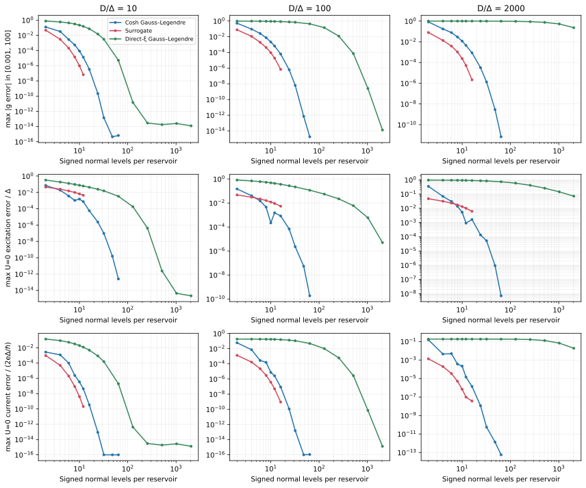

# Choosing and refining superconducting reservoirs

The reservoir approximation determines which continuum problem a finite
calculation represents. Choose the physical gap and half-bandwidth first,
then choose a representation and demonstrate convergence for the observable
you intend to report. The number of leads, signed normal levels, spin modes
and retained quasiparticles must be distinguished.

## Choose a representation

| Representation | Typical use | What to inspect |
|---|---|---|
| `cosh_grid` | A transparent quadrature for a flat finite band | Level-pair refinement and the normal-measure diagnostic |
| `fit_surrogate` | Compact fits to the imaginary-frequency hybridization | Fitting interval, objective, initial guesses, seed and independent validation error |
| `chain_expansion` | Deterministic Padé-derived reservoirs, returned in star coordinates | Signed level count, odd/even sequences and finite/wide-band target |
| `DiscreteBath` | Explicit or independently designed quadrature | Nodes, positive weights, density normalization and provenance |

The [constructor reference](reference/models.md) lists parameters and defaults.
The detailed [bath representation guide](bath_representations.md) explains the
quadratures and complete benchmarks; [chain expansion](chain_expansion.md)
gives the Padé construction. This chapter explains how to choose and assess a reservoir in practice.

## Construct and retain explicit coefficients

This self-contained example uses the same physical energy scales for all three methods:

```python
import json
from pathlib import Path
from qdjj_solver import DiscreteBath, chain_expansion, cosh_grid, fit_surrogate

grid = cosh_grid(pairs=2, delta=1., bandwidth=10.)
surrogate = fit_surrogate(levels=4, delta=1., bandwidth=10., seed=1729)
chain = chain_expansion(levels=4, delta=1., bandwidth=10.)
Path("bath.json").write_text(json.dumps(grid.record(), indent=2))
restored = DiscreteBath.from_record(json.loads(Path("bath.json").read_text()))
assert restored.levels == grid.levels
```

Four signed normal levels mean eight Bogoliubov spin modes **per lead**. For
`cosh_grid`, `pairs=2` produces those four levels; for the other constructors,
`levels=4` specifies them directly. Equal level counts provide an equal-size
comparison; compare physical observables to assess the accuracy of each bath.

The weights represent the normal-state measure. Preserve their quadrature values
to retain the contact's physical hybridization, including for a coarse rule.
Saving the explicit coefficients separates solver comparisons from fitting
randomness or numerical-library differences in bath construction.

## Inspect the hybridization before solving

```python
import numpy as np
from qdjj_solver.common.baths import discrete_g, hybridization_g

frequencies = np.geomspace(1e-3, 100., 101)
target = hybridization_g(frequencies, delta=1., bandwidth=10.)
for name, bath in [("cosh", grid), ("surrogate", surrogate), ("chain", chain)]:
    error = np.max(abs(discrete_g(bath, frequencies) - target))
    print(name, bath.levels, error)
```

This diagnostic measures the error at the sampled imaginary frequencies.
Also check zero frequency, the fitting interval and relevant frequencies outside it.
Assess the accuracy of a gap-edge excitation or current by refining the bath and
comparing that observable. `max_nfev` sets the computational budget for each fit start;
the resulting accuracy is determined by these separate checks.

## Refine the physical observable

1. Fix the physical Hamiltonian and the target continuum: gap, bandwidth,
   couplings, phase, field, detuning and energy reference.
2. Choose a bath sequence. For surrogate and chain families inspect odd and
   even sizes separately where their structure differs.
3. At each size, converge the finite problem using the QP cutoff or MPS bond
   limit. Record the controls needed to reach convergence at that size.
4. Compare the actual excitation, current or correlation being reported.
5. Repeat with an independently motivated representation when near the gap
   edge or where a small difference decides a parity boundary.
6. Report unresolved changes and the scope of the reference calculation.

Keep the bath fixed when comparing QP and DMRG, and keep the physical bandwidth
fixed during a finite-band refinement. `wide_band=True` in `chain_expansion`
selects an infinite-band target; its bandwidth parameter then specifies only
the density normalization.

## Interpret comparative evidence



This figure presents selected results from the [complete benchmark report](bath_representations.md#measured-comparison),
which specifies the models, quadratures, independent references and hardware.
Kernel, excitation and current errors need not rank the methods identically.
Timings in that study characterize the recorded one-thread Apple M1 Max environment.
Measure runtimes in the intended environment when planning a calculation. The data distinguish equal-size
comparisons from cost at an achieved observable accuracy.

A finite bath replaces continua by discrete states. Its lowest excitation can
lie above the physical gap edge. Use the appropriate continuum threshold when
assessing bound-state binding. A change of coordinates from a star to a chain
preserves a specified finite Hamiltonian, while removing modes or changing
coefficients changes the physical approximation.

## Connect to input files

The top-level `bath` object describes a reference model's reservoir. A general
multiorbital model has its reservoirs under `model.reservoirs`. The
[configuration reference](reference/configuration.md) specifies all four kinds
and the defaults used when fields are omitted. Changing a bath usually changes the
electron-to-canonical transformation, so check compatibility before reusing saved
state vectors or MPS after such a change.
