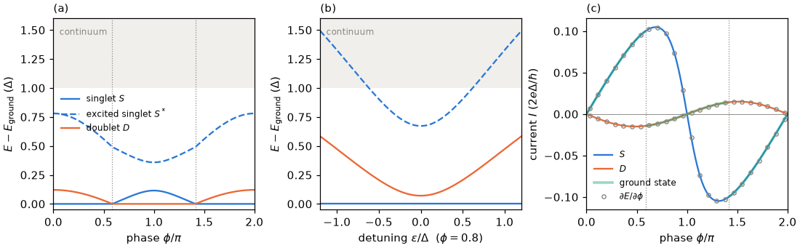

# Tutorial 01: subgap states, singlet and doublet

## Goal

Compute the bound states of the reference junction used throughout the physics manual: the
singlet $S$ and the excited singlet $S^*$ (even fermion parity) and the spin doublet $D$ (odd
parity). The tutorial shows

- their energies at the reference point, and versus the phase difference $\phi$ and the
  detuning $\epsilon$;
- how the ground state is found by comparing the parity sectors, and the singlet–doublet
  (0–π) transition at $E_D=E_S$;
- the supercurrents of $S$ and $D$, which flow in opposite directions, checked against a finite
  difference of the energy.

## Physics in brief

A quantum dot with charging energy $U$ is coupled to two superconducting leads with gap $\Delta$
and phases $\mp\phi/2$. The dot Hamiltonian is written relative to half filling,

```math
H_d=\frac U2(n_d-1)^2+\epsilon(n_d-1),\qquad \epsilon=\epsilon_d+\frac U2 .
```

Pairing changes the electron number by two, so the fermion parity is conserved and the
calculation is done separately in the even sector, `Sector(0, 0)`, and in the odd sector,
`Sector(1, 1)` ($S_z=+1/2$). In the large-gap limit the leads induce a local pairing
$\Gamma_\phi=\Gamma\cos(\phi/2)$, where $\Gamma$ is the total hybridization. The empty and doubly
occupied dot configurations then hybridize into two singlets, while the doublet is unaffected:

```math
E_{S,S^*}=\frac U2\mp\sqrt{\epsilon^2+\Gamma_\phi^2},\qquad E_D=0 .
```

The ground state is a singlet when $\sqrt{\epsilon^2+\Gamma_\phi^2}>U/2$ and a doublet
otherwise. Since $\lvert\Gamma_\phi\rvert$ is smallest at $\phi=\pi$, the phase drives the
singlet–doublet transition. For $\Delta$ comparable with $U$ and $\Gamma$, quasiparticles of the
leads also take part in the bound states, so these formulas are only qualitative; the
calculation below includes them. The continuum begins one quasiparticle above the ground
state, at $E_{\mathrm{ground}}+\Delta$.

The supercurrent follows from the phase dependence of the energy (Hellmann–Feynman),

```math
I=\frac{2e}{\hbar}\frac{\partial E}{\partial\phi}=\frac{2e}{\hbar}\left\langle\frac{\partial H}{\partial\phi}\right\rangle .
```

The observable `phase_derivative` is $\partial H/\partial\phi$ in units of $\Delta$, so its
expectation value is the current in units of $2e\Delta/\hbar$. The singlet energy is lowest at
$\phi=0$ (a 0 junction, $I_S>0$ for $0<\phi<\pi$); the doublet energy is lowest at $\phi=\pi$
(a π junction, $I_D<0$).

## Physics manual

<!-- BEGIN generated: physics-manual (tools/gen_docs.py) -->
The physics behind this tutorial is explained in the
[physics manual](../../docs/manual/README.md):

- section “Subgap states: singlet and doublet” (`sec:subgap`)
- chapter “The model” (`ch:model`)
- chapter “Static solution methods” (`ch:static`)
<!-- END generated: physics-manual -->

## Run

From the repository root, after `python -m pip install '.[plots]'` (matplotlib is needed only
for the figure):

```sh
python -B examples/01_subgap_states/run.py                    # quick: coarse scans, about 3 s
python -B examples/01_subgap_states/run.py --profile full     # dense scans, about 10 s
```

Both profiles use the reference junction of the physics manual: $U=1$, $\Gamma=0.5$ (0.25 per
lead), $\epsilon=0.2$, $\phi=0.8$, half-bandwidth $D=10$, $\Delta=1$, a `cosh_grid` bath with
four level pairs per lead, `symmetry=False`, `compress=False` and QP cutoff two. The quick
profile scans 25 phases and 25 detunings and compares the current with the finite difference at
four phases. The full profile scans 121 phases and 97 detunings and compares the currents at 24
phases. The single-point results do not depend on the scans and are identical in both
profiles. Results are written to `runs/examples/01_subgap_states/<profile>/`: `results.json`
with the numbers below and the scans, and `subgap_states.png`.

## Expected results

<!-- BEGIN generated: expected-results (tools/gen_docs.py) -->
`python tools/check_tutorials.py 01_subgap_states` runs the quick profile and compares it with
[`reference/quick.json`](reference/quick.json); add `--profile full` for
[`reference/full.json`](reference/full.json).

| Quantity | Key | Quick profile | Full profile | Tolerance |
|---|---|---|---|---|
| Singlet energy $E_S$ at the reference point | `singlet_energy` | -0.822154 | -0.822154 | ±1e-09 |
| Excited-singlet energy $E_{S^*}-E_S$ | `excited_energy` | 0.715993 | 0.715993 | ±1e-09 |
| Doublet energy $E_D-E_S$ | `doublet_energy` | 0.095788 | 0.095788 | ±1e-09 |
| Ground-state parity at $\phi=0.8$ (0 even, 1 odd) | `ground_parity` | 0 | 0 | exact |
| Difference of $E_D$ between $S_z=+1/2$ and $-1/2$ (spin symmetry) | `doublet_sz_splitting` | at most 1e-10 | at most 1e-10 | upper bound |
| Current of $S$, $\langle\partial H/\partial\phi\rangle$ in units of $\Delta$ | `current_singlet` | 0.050348 | 0.050348 | ±1e-09 |
| Current of $D$, $\langle\partial H/\partial\phi\rangle$ in units of $\Delta$ | `current_doublet` | -0.011114 | -0.011114 | ±1e-09 |
| Largest difference between $\langle\partial H/\partial\phi\rangle$ and the finite difference $\partial E/\partial\phi$ | `current_deviation` | at most 1e-08 | at most 1e-08 | upper bound |
| Singlet–doublet transition phase $\phi_c$ (radians) | `critical_phase` | 1.842597 | 1.842597 | ±1e-08 |
| Ground-state parity at $\phi=\pi$ | `ground_parity_pi` | 1 | 1 | exact |
| $E_D-E_S$ at $\phi=\pi$ | `doublet_energy_pi` | -0.115092 | -0.115092 | ±1e-09 |
| $E_D-E_S$ at $\epsilon=0$, $\phi=0.8$ | `doublet_energy_half_filling` | 0.070905 | 0.070905 | ±1e-09 |
| Largest difference between energies at $\epsilon$ and $-\epsilon$ | `particle_hole_asymmetry` | at most 1e-10 | at most 1e-10 | upper bound |
| Deviation from the atomic energies at $\Gamma=0$ | `atomic_deviation` | at most 1e-12 | at most 1e-12 | upper bound |
<!-- END generated: expected-results -->

The full profile reproduces the subgap spectrum of section “Subgap states: singlet and doublet”
(`sec:subgap`) in panels (a) and (b), and adds the currents in panel (c):



## What to look at

- **Panel (a).** At small phases the singlet is the ground state. The doublet crosses it at
  $\phi_c=1.843$ (about $0.59\pi$) and remains the ground state up to $2\pi-\phi_c$. At the
  reference point $E_D-E_S=0.096$, and the excited singlet lies at $E_{S^*}-E_S=0.716$, well
  below the continuum. The pair transition $S\to S^*$ is driven in tutorials
  [06](../06_phase_drive/README.md), [07](../07_gate_drive/README.md) and
  [08](../08_two_tone/README.md).
- **Ground-state parity.** A single sector does not determine the ground state: the script
  compares the lowest energies of the even and the odd sector. At zero field the doublet partners
  `Sector(1, 1)` and `Sector(1, -1)` are degenerate to machine precision; at finite field both
  must be compared.
- **Panel (b).** At $\phi=0.8$ the singlet remains the ground state for every detuning of the scan;
  $E_D-E_S$ is smallest at half filling, $0.071$ at $\epsilon=0$. The spectrum is symmetric in
  $\epsilon$, by particle–hole symmetry. At large $\lvert\epsilon\rvert$ the excited singlet enters
  the shaded region, but it stays below $E_D+\Delta$, where the continuum of the even sector
  (the doublet plus one quasiparticle) begins.
- **Panel (c).** $I_S$ and $I_D$ have opposite signs: the singlet forms a 0 junction and the
  doublet a π junction. The ground-state current (aqua) jumps and reverses at $\phi_c$. The
  circles, finite differences $\partial E/\partial\phi$, lie on the curves. The
  Hellmann–Feynman relation is exact for eigenstates of the truncated Hamiltonian, and the two
  agree to better than $10^{-9}$.
- **Large-gap limit.** The formulas above predict the transition at $\phi_c\approx0.82$, while the
  finite-gap calculation gives $1.84$. At $\Delta=1$ virtual quasiparticle excitations of the leads
  lower the singlet more than the doublet, which moves the transition to larger phases.
- **Atomic limit.** At $\Gamma=0$ the energies are exactly $U/2-\epsilon$, $U/2+\epsilon$ and $0$.
  The decoupled Hamiltonian is diagonal with highly degenerate levels and an exactly zero doublet
  energy. Plain ARPACK cannot converge an exactly zero eigenvalue; the solver iterates with a
  shifted operator and checks the result against a bound from the diagonal elements
  ([numerics](../../docs/numerics.md#qp-diagonalization)), so the default method reproduces the
  atomic energies to rounding error.
- **What is converged.** The energies are those of the finite bath at QP cutoff two. The small
  eigensolver residuals do not establish convergence in the QP cutoff or in the bath
  discretization; those are separate checks.

## Try next

- Set `detuning=0.` in `JUNCTION` and follow $\phi_c$; then try `u=2.` and see whether a
  singlet ground state survives at $\phi=0$.
- Raise `CUTOFF` to 3, or the number of bath `pairs` to 6 or 8, and watch how
  $E_D-E_S$ changes: QP-cutoff and bath convergence must be checked separately.
- Add a Zeeman field (`field=0.02`) and compare `Sector(1, 1)` and `Sector(1, -1)`: the doublet
  splits, and the global ground state needs both spin projections.
- Evaluate the large-gap energies $U/2\mp\sqrt{\epsilon^2+\Gamma_\phi^2}$ along the phase scan and
  compare them with panel (a).
- Measure the singlet and doublet [local orbital density matrices](../../docs/interfaces.md#local-orbital-density-matrices).
  Compare the single-occupancy probability and pair coherence even where their mean charges agree.
- Repeat a fixed-bath calculation with a [QP workspace](../../docs/qp_workflow.md#reuse-preparation-and-check-spectrum-coverage)
  and check its reuse diagnostics and independent state count against dense diagonalization.

## Files

| File | Content |
|---|---|
| [`run.py`](run.py) | The calculation: reference point, phase and detuning scans, current check and the figure |
| [`reference/quick.json`](reference/quick.json), [`reference/full.json`](reference/full.json) | Expected values and tolerances |
| [`expected.png`](expected.png) | Figure of the full profile |

The script builds the junction with `reference_model` and a `cosh_grid` bath, solves the even
and odd sectors with `solve(h, cutoff, Sector(...), SolverOptions(eigenpairs=...))`, reads
`result.observables["phase_derivative"]` for the currents and locates $\phi_c$ with Brent's
method on $E_D-E_S$.

## See also

- [Physical models and conventions](../../docs/models.md): the
  [energy reference](../../docs/models.md#units-and-energy-reference),
  [`reference_model`](../../docs/models.md#reference_model) and
  [currents](../../docs/models.md#physical-derivatives-and-transitions)
- [Using the solver and saving results](../../docs/interfaces.md)
- [Numerical methods and convergence](../../docs/numerics.md), including the
  [worked parity and current example](../../docs/numerics.md#worked-parity-and-current-example)
- [Observable reference](../../docs/reference/observables.md)
- The [tutorial index](../README.md)
