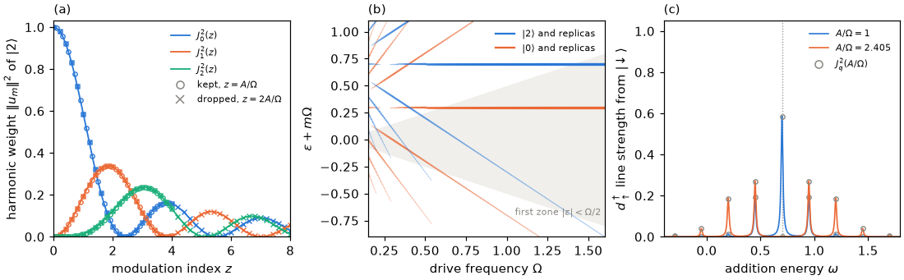

# Tutorial 02: the gate-driven isolated dot

## Goal

Drive a quantum dot without leads through its gate, $\epsilon(t)=\epsilon_0+A\cos\Omega t$, and
check the Floquet calculation against the exact solution:

- the quasienergies equal the static energies for every drive;
- the harmonic weights (photon sidebands) are squared Bessel functions of the modulation
  index and depend on the constant term of the Hamiltonian;
- the replicas $\varepsilon+m\Omega$ and their folding into the first Floquet zone;
- the Tien–Gordon sidebands measured by a tunnelling probe.

## Physics in brief

The isolated dot with a gate drive,

```math
H(t)=H_d(\epsilon_0)+A\cos(\Omega t)\,(n_d-1),\qquad H_d=\frac U2(n_d-1)^2+\epsilon_0(n_d-1),
```

has every Fock state $\vert n\rangle$ of charge $n$ as an eigenstate at all times. The
solution of the Schrödinger equation acquires only a time-dependent phase,

```math
\psi_n(t)=e^{-iE_nt}\,e^{-iq_n(A/\Omega)\sin\Omega t}\,\vert n\rangle,\qquad q_n=n-1 .
```

The quasienergy is the static energy, $\varepsilon_n=E_n$, for every amplitude: a drive that only
shifts a level up and down does not change its time-averaged energy. Expanding the periodic
phase in Bessel functions gives the harmonic weights of the Floquet mode,

```math
\lVert u_{n,m}\rVert^2=J_m^2\left(\frac{q_nA}{\Omega}\right).
```

They depend only on the modulation index $q_nA/\Omega$. The value of $q_n$ depends on the
constant in $H_d$: writing the drive as $`A\cos(\Omega t)\,n_d`$ gives $q_n=n$ instead. The two forms
differ by a c-number $A\cos\Omega t$, a gauge transformation that leaves the quasienergies
unchanged. The solver keeps these c-number terms by default; `drop_scalar_harmonics=True`
removes their oscillating part.

The pairs $(\varepsilon+\ell\Omega,u_{m-\ell})$ describe the same state for every integer $\ell$. The
replicas $\varepsilon+m\Omega$ are all valid quasienergies, and the first zone
$\lvert\varepsilon\rvert<\Omega/2$ is one choice of representatives (the result field `folded`).

A tunnelling probe that adds an electron connects states whose charges differ by one, so it
involves the relative modulation index $A/\Omega$ in either gauge. The addition spectrum from
$\vert\downarrow\rangle$ into $\vert2\rangle$ consists of lines at $E_2-E_\downarrow+q\Omega$ with
strengths $J_q^2(A/\Omega)$: the photon-assisted tunnelling of Tien and Gordon. At the first zero
of $J_0$, $A/\Omega=2.405$, the central line disappears.

## Physics manual

<!-- BEGIN generated: physics-manual (tools/gen_docs.py) -->
The physics behind this tutorial is explained in the
[physics manual](../../docs/manual/README.md):

- chapter “Example: the gate-driven isolated dot” (`ch:ex-dot`)
- section “Gauge freedom and the energy zero” (`sec:gauge`)
- chapter “Probing the driven junction” (`ch:probes`)
<!-- END generated: physics-manual -->

## Run

From the repository root, after `python -m pip install '.[plots]'` (matplotlib is needed only
for the figure):

```sh
python -B examples/02_driven_dot/run.py                    # quick: about 1.5 s
python -B examples/02_driven_dot/run.py --profile full     # the complete figure, about 3 s
```

Both profiles use the dot of the physics manual, $U=1$ and $\epsilon_0=0.2$, so that
$E_{\vert0\rangle}=0.3$, $E_{\vert2\rangle}=0.7$ and $E_{\vert\sigma\rangle}=0$, with the Floquet
cutoff $M=24$. The quick profile computes the harmonic weights at 9 modulation indices (with
$\Omega=1$), the replicas at 30 drive frequencies (with $A=0.6$) and the probe spectrum at
$\Omega=0.25$ for $A/\Omega=1$ and $2.405$. The full profile uses 41 modulation indices, 146
drive frequencies and six probe amplitudes. Results are written to
`runs/examples/02_driven_dot/<profile>/`: `results.json` with the numbers below, the weights,
the replicas and the probe lines, and `driven_dot.png`.

## Expected results

<!-- BEGIN generated: expected-results (tools/gen_docs.py) -->
`python tools/check_tutorials.py 02_driven_dot` runs the quick profile and compares it with
[`reference/quick.json`](reference/quick.json); add `--profile full` for
[`reference/full.json`](reference/full.json).

| Quantity | Key | Quick profile | Full profile | Tolerance |
|---|---|---|---|---|
| Largest difference between quasienergies and static energies | `quasienergy_deviation` | at most 1e-10 | at most 1e-10 | upper bound |
| Weight of $m=0$ at $A/\Omega=0.6$, $J_0^2(0.6)$ | `weight_m0` | 0.831753 | 0.831753 | ±1e-10 |
| Weight of $m=1$ at $A/\Omega=0.6$, $J_1^2(0.6)$ | `weight_m1` | 0.082197 | 0.082197 | ±1e-10 |
| Weight of $m=0$ of $\vert2\rangle$ with dropped constants, $J_0^2(1.2)$ | `weight_m0_dropped` | 0.450419 | 0.450419 | ±1e-10 |
| Largest deviation from $J_m^2((n-1)A/\Omega)$, constants kept | `bessel_deviation_kept` | at most 1e-10 | at most 1e-10 | upper bound |
| Largest deviation from $J_m^2(nA/\Omega)$, constants dropped | `bessel_deviation_dropped` | at most 1e-10 | at most 1e-10 | upper bound |
| Largest error of a folded quasienergy: distance from $E_n$ modulo $\Omega$, or from the first zone | `folding_deviation` | at most 1e-10 | at most 1e-10 | upper bound |
| Central tunnelling line at $A/\Omega=1$, $J_0^2(1)$ | `sideband_0` | 0.585527 | 0.585527 | ±1e-10 |
| First sideband at $A/\Omega=1$, $J_1^2(1)$ | `sideband_1` | 0.193645 | 0.193645 | ±1e-10 |
| Central line at the first zero of $J_0$ | `central_line_at_zero` | at most 1e-12 | at most 1e-12 | upper bound |
| Deviation of the summed line strengths from one | `sum_rule_deviation` | at most 1e-10 | at most 1e-10 | upper bound |
| Largest deviation of a line strength from $J_q^2(A/\Omega)$ | `sideband_deviation` | at most 1e-10 | at most 1e-10 | upper bound |
| Largest deviation of a line from $E_2-E_\downarrow+q\Omega$ | `sideband_frequency_deviation` | at most 1e-10 | at most 1e-10 | upper bound |
<!-- END generated: expected-results -->

The full profile reproduces the figure of chapter “Example: the gate-driven isolated dot”
(`ch:ex-dot`) in panels (a) and (b), with the dropped-constant gauge added to panel (a), and
shows the Tien–Gordon sidebands in panel (c):



## What to look at

- **Quasienergies.** They stay at 0.3 and 0.7 for every amplitude and frequency, within
  $10^{-13}$.
- **Panel (a).** The harmonic weights of $\vert2\rangle$ collapse onto $J_m^2(z)$ when plotted
  against the modulation index: $z=A/\Omega$ with the constants kept (circles) and $z=2A/\Omega$
  with them dropped (crosses). With the constants kept, $\vert0\rangle$ and $\vert2\rangle$ have
  the same weights ($\lvert q_n\rvert=1$). With them dropped, $\vert0\rangle$ has no sidebands at all
  and $\vert2\rangle$ has twice the modulation index, which needs a larger Floquet cutoff. For the
  example in the physics manual, $A=0.6$ and $\Omega=1$, the central weight is
  $J_0^2(0.6)=0.8318$ for both states.
- **Panel (b).** At low frequency the modulation index $A/\Omega$ is large and the weight spreads
  over many replicas; at high frequency it concentrates in $m=0$. Replicas of $\vert0\rangle$ and
  $\vert2\rangle$ cross exactly, because nothing couples the two states. The shaded region is the
  first zone, which contains the `folded` quasienergies.
- **Panel (c).** At $A/\Omega=1$ the central line carries $J_0^2(1)=0.5855$ and the first sidebands
  $J_1^2(1)=0.1936$. At $A/\Omega=2.405$ the central line vanishes, so `lines()` omits it (it
  drops lines weaker than $10^{-12}$ of the strongest), and the weight moves into the
  sidebands. In both cases the strengths add up to
  $\lvert\langle2\vert d^\dagger_\uparrow\vert\downarrow\rangle\rvert^2=1$: the sum rule.
- **Gauge invariance.** The lines are identical with the constants kept or dropped: a physical
  transition depends only on charge differences.

## Try next

- Drive the charging energy instead of the gate: build the dot from
  `Impurity.anderson(U + amplitude*np.cos(omega*t), EPSILON)`. The term $\tfrac U2(n_d-1)^2$
  moves $\vert0\rangle$ and $\vert2\rangle$ together and leaves $\vert\sigma\rangle$ in place, so
  the addition line has the modulation index $A/(2\Omega)$.
- Add a second harmonic, $\epsilon(t)=\epsilon_0+A\cos\Omega t+A_2\cos2\Omega t$. Eight samples
  still represent it exactly, and the sidebands follow generalized Bessel functions.
- Probe electron removal with `annihilate(1)` ($d_\downarrow$) from $\vert\downarrow\rangle$ into
  $\vert0\rangle$, with lines at $E_0-E_\downarrow+q\Omega$.
- Add the induced pairing of [tutorial 03](../03_two_level_system/README.md): the replicas of
  $\vert0\rangle$ and $\vert2\rangle$ then anticross at multiphoton resonances.

## Files

| File | Content |
|---|---|
| [`run.py`](run.py) | The calculation: Bessel weights in both gauges, the replica fan, the tunnelling lines and the figure |
| [`reference/quick.json`](reference/quick.json), [`reference/full.json`](reference/full.json) | Expected values and tolerances |
| [`expected.png`](expected.png) | Figure of the full profile |

The script builds the dot as a `Hamiltonian` from `Impurity.anderson` and the drive with
`PeriodicHamiltonian.from_callable(..., assume_fixed_coordinates=True)`: a bare impurity has no
reservoir and declares no canonical coordinates. It solves the Sambe problem with
`solve_floquet(periodic, 0, Sector(...), dict(floquet_cutoff=24, states=..., drop_scalar_harmonics=...))`
and reads `quasienergies`, `folded` and `harmonic_weights`. Such a Hamiltonian also declares no
map from electron operators to its modes, so the tunnelling probe is the operator `create(0)`
($d^\dagger_\uparrow$; mode 0 is spin up) rather than the name `"d_up_dagger"`. The script
passes it to `FloquetStates.matrix_elements` between the two parity sectors and obtains the
spectral lines with `lines()`.

## See also

- [Floquet calculations](../../docs/floquet.md): [conventions](../../docs/floquet.md#conventions),
  the scalar harmonics, and [transitions and spectra](../../docs/floquet.md#transitions-and-spectra)
- [Option reference](../../docs/reference/options.md#floquet-calculations) and
  [result reference](../../docs/reference/results.md#floquet-states)
- [Physical models and conventions](../../docs/models.md#units-and-energy-reference): the dot
  Hamiltonian and its energy zero
- The [tutorial index](../README.md)
