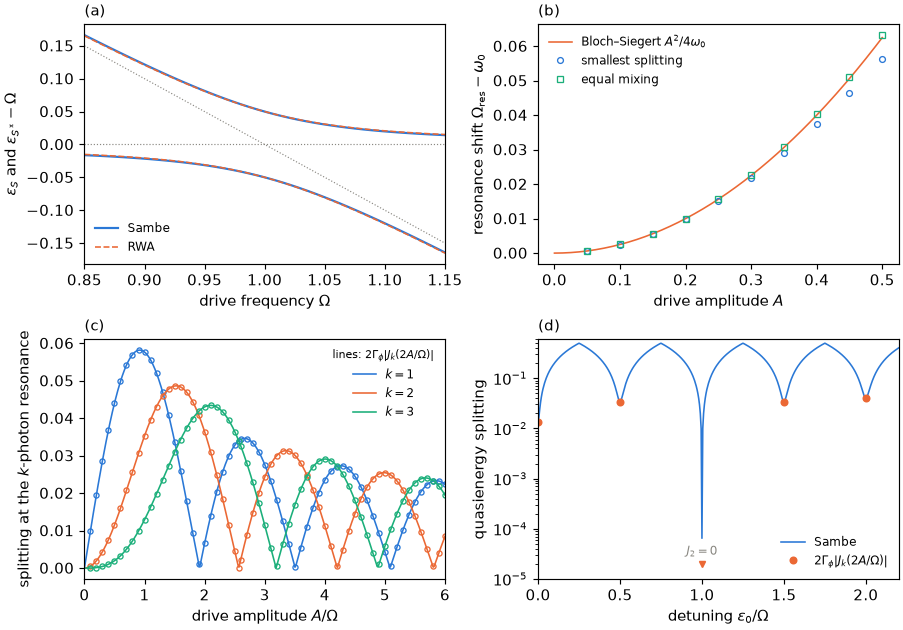

# Tutorial 03: the proximitized dot as a driven two-level system

## Goal

Drive the even sector of a proximitized quantum dot through its gate and compare the exact
Floquet (Sambe) quasienergies with standard approximations for a driven two-level system:

- the Autler–Townes avoided crossing versus the drive frequency, against the rotating-wave
  approximation (RWA) computed with `rwa_model`;
- the Rabi splitting at resonance and the Bloch–Siegert shift of the resonance, for a weak and
  a stronger drive;
- the multiphoton resonances of a strongly driven, weakly coupled dot, whose splittings follow
  Bessel functions and vanish at their zeros.

## Physics in brief

In the large-gap limit the leads induce a local pairing $\Gamma_\phi$ on the dot,
$H=H_d-(\Gamma_\phi d^\dagger_\uparrow d^\dagger_\downarrow+\mathrm{h.c.})$. The even sector
contains only the empty and doubly occupied dot configurations, so it is a two-level system with the
pseudospin Hamiltonian

```math
H=\frac U2+\epsilon\,\tau_z-\Gamma_\phi\,\tau_x,\qquad \omega_0=E_{S^*}-E_S=2\sqrt{\epsilon^2+\Gamma_\phi^2},
```

where $\tau_z=n_d-1$ is $+1$ for $\vert2\rangle$ and $-1$ for $\vert0\rangle$. A gate drive adds
$`A\cos(\Omega t)\,\tau_z`$. At $\epsilon_0=0$ the eigenstates are $(\vert0\rangle\pm\vert2\rangle)/\sqrt2$,
$\omega_0=2\Gamma_\phi$, and the drive is purely transverse. Near $\Omega=\omega_0$ the state
$\vert S,0\rangle$ (no photon exchanged) is resonant with $\vert S^*,-1\rangle$ (one photon
absorbed). Keeping only these two gives the rotating-wave model

```math
Q^{\mathrm{RWA}}=\begin{pmatrix}E_S & A/2\\ A/2 & E_{S^*}-\Omega\end{pmatrix},\qquad
\varepsilon_\pm=\frac{E_S+E_{S^*}-\Omega}{2}\pm\frac12\sqrt{(\omega_0-\Omega)^2+A^2}.
```

At resonance the dressed states are equal mixtures of $S$ and $S^*$, split by the Rabi frequency
$A$. The neglected counter-rotating terms shift the resonance to

```math
\Omega_{\mathrm{res}}=\omega_0+\frac{A^2}{4\omega_0}+O(A^4),
```

the Bloch–Siegert shift. For a large detuning $\epsilon_0\gg\Gamma_\phi$ and a strong drive
$A\gtrsim\Omega$, the states $\vert0\rangle$ and $\vert2\rangle$ are nearly eigenstates and the
weak pairing induces $k$-photon transitions at $2\epsilon_0=k\Omega$, with the splitting

```math
\delta_k=2\Gamma_\phi\left\lvert J_k\left(\frac{2A}{\Omega}\right)\right\rvert\qquad(\Gamma_\phi\ll\Omega).
```

At a zero of $J_k$ the $k$-photon resonance disappears and the two levels cross: coherent
destruction of tunnelling.

## Physics manual

<!-- BEGIN generated: physics-manual (tools/gen_docs.py) -->
The physics behind this tutorial is explained in the
[physics manual](../../docs/manual/README.md):

- chapter “Example: the proximitized dot as a driven two-level system” (`ch:ex-tls`)
- section “The driven proximitized dot” (`sec:driven-largegap`)
- section “The rotating-wave model” (`sec:rwa`)
<!-- END generated: physics-manual -->

## Run

From the repository root, after `python -m pip install '.[plots]'` (matplotlib is needed only
for the figure):

```sh
python -B examples/03_two_level_system/run.py                    # quick: about 4 s
python -B examples/03_two_level_system/run.py --profile full     # the complete figure, about 30 s
```

Both profiles use the parameters of the physics manual: $U=1$; $\epsilon_0=0$,
$\Gamma_\phi=0.5$ ($\omega_0=1$) and $A=0.1$ for the weak drive; $\Gamma_\phi=0.05$ and
$\Omega=1$ for the strong drive; the Floquet cutoff is $M=32$. The quick profile computes 31
drive frequencies, the resonance at $A=0.1$, $0.3$ and $0.5$, the multiphoton splittings at five
amplitudes and the detuning scan of panel (d) at 45 points. The full profile computes 121
frequencies, 10 amplitudes of the resonance search, 61 multiphoton amplitudes and 441 points of
the detuning scan. The reported single-point values are the same in both profiles. Results are written to
`runs/examples/03_two_level_system/<profile>/`: `results.json` with the numbers below and the
curves, and `two_level_system.png`.

## Expected results

<!-- BEGIN generated: expected-results (tools/gen_docs.py) -->
`python tools/check_tutorials.py 03_two_level_system` runs the quick profile and compares it with
[`reference/quick.json`](reference/quick.json); add `--profile full` for
[`reference/full.json`](reference/full.json).

| Quantity | Key | Quick profile | Full profile | Tolerance |
|---|---|---|---|---|
| Level splitting $\omega_0=E_{S^*}-E_S$ | `omega0` | 1.000000 | 1.000000 | ±1e-10 |
| Gate matrix element $\lvert\langle S\vert n_d\vert S^*\rangle\rvert$ | `element` | 1.000000 | 1.000000 | ±1e-10 |
| RWA splitting at $\Omega=\omega_0$, $A=0.1$ | `rabi_rwa` | 0.100000 | 0.100000 | ±1e-10 |
| Sambe splitting at $\Omega=\omega_0$, $A=0.1$ | `splitting_bare_resonance` | 0.099969 | 0.099969 | ±1e-09 |
| Largest difference between the Sambe and RWA quasienergies in the sweep | `rwa_deviation` | 0.001107 | 0.001107 | ±1e-09 |
| Resonance shift $\Omega_{\mathrm{res}}-\omega_0$ (smallest splitting) at $A=0.1$ | `bloch_siegert_shift` | 0.002489 | 0.002489 | ±2e-07 |
| The same, in units of $A^2/4\omega_0$ | `bloch_siegert_ratio` | 0.9956 | 0.9956 | ±1e-04 |
| Splitting at the resonance, $A=0.1$ | `resonance_splitting` | 0.099938 | 0.099938 | ±1e-09 |
| Shift of the equal-mixing resonance in units of $A^2/4\omega_0$, $A=0.1$ | `mixing_shift_ratio` | 1.0006 | 1.0006 | ±1e-08 |
| Shift (smallest splitting) in units of $A^2/4\omega_0$, $A=0.5$ | `stronger_shift_ratio` | 0.8991 | 0.8991 | ±1e-05 |
| Shift (equal mixing) in units of $A^2/4\omega_0$, $A=0.5$ | `stronger_mixing_ratio` | 1.0116 | 1.0116 | ±1e-08 |
| Splitting at the resonance divided by $A$, $A=0.5$ | `stronger_splitting_ratio` | 0.9850 | 0.9850 | ±1e-09 |
| Two-photon splitting at $2A/\Omega=2$, $\Gamma_\phi=0.05$ | `two_photon_splitting` | 0.035278 | 0.035278 | ±1e-09 |
| The same, divided by $2\Gamma_\phi\lvert J_2(2A/\Omega)\rvert$ | `two_photon_ratio` | 0.99985 | 0.99985 | ±1e-07 |
| Two-photon splitting at the first zero of $J_2(2A/\Omega)$ | `collapsed_splitting` | 6.47e-05 | 6.47e-05 | ±1e-09 |
| Largest difference from $2\Gamma_\phi\lvert J_k(2A/\Omega)\rvert$, $k=1,2,3$ | `multiphoton_deviation` | at most 2e-04 | at most 2e-04 | upper bound |
| Largest Sambe residual bound | `max_residual` | at most 1e-10 | at most 1e-10 | upper bound |
<!-- END generated: expected-results -->

The full profile reproduces panels (a) and (c) of the weak-drive figure and both panels of the
strong-drive figure of chapter “Example: the proximitized dot as a driven two-level system”
(`ch:ex-tls`), and adds a second definition of the resonance to panel (b):



## What to look at

- **The two levels.** $\omega_0=1$ and $\lvert\langle S\vert n_d\vert S^*\rangle\rvert=1$: at
  $\epsilon_0=0$ the gate couples $S$ and $S^*$ as strongly as possible.
- **Panel (a).** The rotating-frame quasienergies $\varepsilon_S$ and $\varepsilon_{S^*}-\Omega$ avoid
  each other at resonance; the dotted lines are the undriven $E_S$ and $E_{S^*}-\Omega$. The RWA
  (dashed) follows the Sambe result to within $1.1\times10^{-3}$ over the whole sweep. At
  $\Omega=\omega_0$ the RWA splitting is exactly $A=0.1$, the Sambe splitting $0.09997$: the
  resonance has moved.
- **Panel (b).** The resonance, found as the smallest splitting, shifts by $0.002489$ at $A=0.1$,
  $0.9956$ times the Bloch–Siegert value, and the splitting there is $0.099938$, equal to $A$ up
  to a relative $6\times10^{-4}$. A second definition of the resonance is equal mixing of $S$
  and $S^*$ in the time-averaged dressed states, where the time-averaged probability of a
  transition from $S$ to $S^*$ equals $1/2$. The two definitions agree to order $A^2$ and
  differ at order $A^4$. At $A=0.5$ the smallest splitting gives $0.899$ times the
  Bloch–Siegert shift and equal mixing $1.012$ times it; the splitting is $0.985A$. The
  perturbative formulas lose accuracy as $A$ approaches $\omega_0$.
- **Panel (c).** The $k$-photon splittings follow $2\Gamma_\phi\lvert J_k(2A/\Omega)\rvert$ to within
  $1.2\times10^{-4}$ (with $2\Gamma_\phi=0.1$), including their zeros. At $2A/\Omega=2$ the
  two-photon splitting is $0.035278$, $0.99985$ times the predicted value. The search for the smallest
  splitting near $2\epsilon_0=k\Omega$ absorbs the small level shifts of order
  $\Gamma_\phi^2/\Omega$ that detune the resonance; evaluated at exactly $2\epsilon_0=k\Omega$,
  the splittings at small $A/\Omega$ are slightly larger.
- **Panel (d).** At $A=j_{2,1}\Omega/2=2.568\Omega$, the first zero of $J_2(2A/\Omega)$, the
  $k=1$, $3$ and $4$ resonances are avoided crossings of the predicted size, while the two-photon
  splitting has collapsed to $6.5\times10^{-5}$, a remainder of higher order in $\Gamma_\phi/\Omega$
  (compare the maximum $0.049$ of $2\Gamma_\phi\lvert J_2\rvert$). The $k=1$ and $k=3$ splittings are
  equal there, because $J_1(z)+J_3(z)=(4/z)J_2(z)$ vanishes.
- **Convergence.** The largest Sambe residual bound is below $10^{-13}$: the cutoff $M=32$
  exceeds the modulation index $A/\Omega\le6$ plus the few photons by which the detuning
  displaces the modes.

## Try next

- Set `WEAK["epsilon"]` to 0.3. The drive acquires a longitudinal part, the matrix element
  drops to $\Gamma_\phi/\sqrt{\epsilon_0^2+\Gamma_\phi^2}=0.86$, and the Rabi splitting with it.
  The level splitting grows to $\omega_0=1.17$, so move the `sweep` range in `PROFILES` to
  follow the crossing in panel (a).
- Raise `WEAK["amplitude"]` to 0.5 and watch the RWA curves in panel (a) separate from the
  Sambe result.
- Follow the second zero of $J_2$, at $A/\Omega=4.209$, where the two-photon resonance collapses
  again.
- Compute the same quasienergies with `floquet_propagator`, which integrates over one period
  without a Floquet cutoff, as an independent check.

## Files

| File | Content |
|---|---|
| [`run.py`](run.py) | The calculation: Autler–Townes sweep with the RWA, resonance search, multiphoton splittings, detuning scan and the figure |
| [`reference/quick.json`](reference/quick.json), [`reference/full.json`](reference/full.json) | Expected values and tolerances |
| [`expected.png`](expected.png) | Figure of the full profile |

The script builds the proximitized dot from `Impurity.anderson` plus the pairing term
`hermitian_pair(-pairing*create(0)*create(1))`, wraps it as a `Hamiltonian` and drives it with
`PeriodicHamiltonian.from_callable(..., assume_fixed_coordinates=True)`. It uses `solve_floquet`
for both Floquet states of the even sector, its `folded` quasienergies with `zone_center` at
$E_S$ and its `static_weights`, and `rwa_model(periodic, states=[0, 1], photons=[0, -1], ...)`
for the RWA.
Resonances are located with SciPy's bounded scalar minimizer and Brent's method.

## See also

- [Floquet calculations](../../docs/floquet.md): the
  [rotating-wave model](../../docs/floquet.md#rotating-wave-model), the
  [one-period propagator](../../docs/floquet.md#one-period-propagator), and
  [convergence and pitfalls](../../docs/floquet.md#convergence-and-pitfalls)
- [Option reference](../../docs/reference/options.md#floquet-calculations) and
  [result reference](../../docs/reference/results.md#floquet-states)
- The [tutorial index](../README.md)
