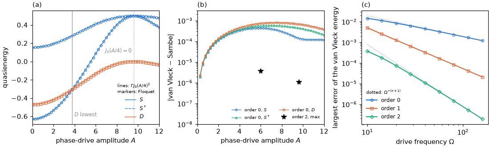

# Tutorial 04: the high-frequency limit

## Goal

Drive the superconducting phase of a quantum-dot Josephson junction much faster than any
internal process, and compute:

- the quasienergies of the singlets $S$, $S^*$ and of the doublet $D$ versus the drive
  amplitude $A$, compared with the static junction with the renormalized coupling
  $\Gamma J_0(A/4)^2$;
- the drive-induced crossing at which the doublet becomes the lowest dressed state, and the
  decoupling of the dot at the first zero of $J_0$;
- the van Vleck effective Hamiltonians of orders 0, 1 and 2, solved like any static
  Hamiltonian and compared with exact Sambe quasienergies, and the scaling of their error with
  $\Omega$.

## Physics in brief

In the reference junction the phase $\phi=\phi_R-\phi_L$ enters each tunnelling amplitude as a
factor $e^{\pm i\phi/4}$. For the drive $\phi(t)=\phi_0+A\cos\Omega t$ the Jacobi–Anger
expansion gives harmonics $H_k\propto J_k(A/4)$, and the time average $H_0$ is the junction
with a renormalized hybridization:

```math
H_0=H(\phi_0)\big\vert_{\Gamma\to\Gamma J_0(A/4)^2}.
```

When $\Omega$ exceeds the width of the many-body spectrum, the quasienergies are the eigenvalues
of the van Vleck effective Hamiltonian

```math
H_{\mathrm{eff}}=H_0+\frac{1}{\Omega}\sum_{m\ge1}\frac{[H_m,H_{-m}]}{m}+O\big(\Omega^{-2}\big),
```

and its truncation at order $n$ has an error of order $\Omega^{-(n+1)}$. A single-parameter
cosine drive is even in time, $H_{-k}=H_k$, so the first-order term vanishes and $H_0$ alone is
accurate to order $\Omega^{-2}$.

As $A$ grows, the effective coupling decreases. The doublet becomes the lowest dressed state
when $\Gamma J_0(A/4)^2$ falls below the critical coupling $\Gamma_c$ of the static
singlet–doublet transition, the 0–π transition of the junction: a level crossing induced by
the drive. At $A=4\times2.405\approx9.62$, the first zero of $J_0(A/4)$, the time-averaged
coupling vanishes and the dot decouples from the leads (coherent destruction of tunnelling).
The atomic levels then return to leading order in $1/\Omega$: at half filling the empty and the
doubly occupied dot, which form the singlets, have energy $U/2$, and the singly occupied dot,
the doublet, has energy 0.

## Physics manual

<!-- BEGIN generated: physics-manual (tools/gen_docs.py) -->
The physics behind this tutorial is explained in the
[physics manual](../../docs/manual/README.md):

- chapter “Example: the high-frequency limit” (`ch:ex-highfreq`)
- section “The high-frequency expansion” (`sec:van-vleck`)
- section “Harmonics of the phase drive” (`sec:jacobi-anger`)
<!-- END generated: physics-manual -->

## Run

From the repository root, after `python -m pip install '.[plots]'` (matplotlib is needed only
for the figure):

```sh
python -B examples/04_high_frequency/run.py                    # quick: 9 amplitudes, about 13 s
python -B examples/04_high_frequency/run.py --profile full     # 49 amplitudes, about 30 s
```

Both profiles use the junction of the physics manual's high-frequency chapter, with energies
in units of the gap $\Delta$: $U=1$, $\Gamma=0.8$ (total hybridization), $\epsilon=0$,
$\phi_0=0.8$, one bath level pair per lead with half-bandwidth $D=2$, QP cutoff 2 and
$\Omega=40$. This small bath keeps $\Omega$ far above the width of the many-body spectrum. The
quick profile scans 9 amplitudes and evaluates the error scaling at $\Omega=20$, 40 and 80; the
full profile scans 49 amplitudes and 9 frequencies from 10 to 160. Results are written to
`runs/examples/04_high_frequency/<profile>/`: `results.json` with the numbers below and the
scans, and `high_frequency.png`.

## Expected results

<!-- BEGIN generated: expected-results (tools/gen_docs.py) -->
`python tools/check_tutorials.py 04_high_frequency` runs the quick profile and compares it with
[`reference/quick.json`](reference/quick.json); add `--profile full` for
[`reference/full.json`](reference/full.json).

| Quantity | Key | Quick profile | Full profile | Tolerance |
|---|---|---|---|---|
| Undriven singlet energy $E_S$ | `energy_S` | -0.629541 | -0.629541 | ±1e-09 |
| Undriven excited-singlet energy $E_{S^*}$ | `energy_Sstar` | 0.155214 | 0.155214 | ±1e-09 |
| Undriven doublet energy $E_D$ | `energy_D` | -0.469732 | -0.469732 | ±1e-09 |
| Largest difference between the quasienergies and the static junction with $\Gamma J_0(A/4)^2$ over the scan | `max_renormalized_deviation` | 7.904e-04 | 7.904e-04 | ±1e-09 |
| Drive amplitude at which $D$ becomes the lowest dressed state | `crossing_amplitude` | 3.7666 | 3.7666 | ±1e-07 |
| Static critical coupling $\Gamma_c$ of the singlet–doublet transition | `critical_gamma` | 0.499836 | 0.499836 | ±1e-08 |
| Crossing predicted by $\Gamma J_0(A/4)^2=\Gamma_c$ | `crossing_renormalized` | 3.7654 | 3.7654 | ±1e-07 |
| Quasienergy of $S$ at $J_0(A/4)=0$ (atomic value $U/2$) | `decoupled_S` | 0.500141 | 0.500141 | ±1e-08 |
| Quasienergy of $S^*$ at $J_0(A/4)=0$ (atomic value $U/2$) | `decoupled_Sstar` | 0.500438 | 0.500438 | ±1e-08 |
| Quasienergy of $D$ at $J_0(A/4)=0$ (atomic value 0) | `decoupled_D` | 0.000666 | 0.000666 | ±1e-08 |
| Van Vleck error of order 0 at $A=6$, largest of $S$, $S^*$, $D$ | `vv0_error` | 7.219e-04 | 7.219e-04 | ±1e-09 |
| Van Vleck error of order 2 at $A=6$ | `vv2_error` | 3.641e-06 | 3.641e-06 | ±1e-10 |
| Van Vleck error of order 2 at $J_0(A/4)=0$ | `vv2_error_decoupled` | 1.093e-06 | 1.093e-06 | ±1e-10 |
| Order 1 minus order 0 for a cosine phase drive, where $H_{-k}=H_k$ | `vv_first_order` | at most 1e-12 | at most 1e-12 | upper bound |
| Order 0 minus the static junction with $\Gamma J_0(A/4)^2$ | `vv0_renormalized` | at most 1e-10 | at most 1e-10 | upper bound |
| One lead, phase and level drive: order-0 error at $\Omega=40$ | `scaling_error0` | 4.555e-03 | 4.555e-03 | ±1e-06 relative |
| One lead, phase and level drive: order-1 error at $\Omega=40$ | `scaling_error1` | 3.250e-04 | 3.250e-04 | ±1e-06 relative |
| One lead, phase and level drive: order-2 error at $\Omega=40$ | `scaling_error2` | 1.091e-05 | 1.091e-05 | ±1e-06 relative |
| Fitted exponent of the order-0 error versus $\Omega$ (asymptotically $-1$) | `scaling_slope0` | -0.925 | -0.944 | ±1e-04 |
| Fitted exponent of the order-1 error versus $\Omega$ (asymptotically $-2$) | `scaling_slope1` | -1.973 | -1.978 | ±1e-04 |
| Fitted exponent of the order-2 error versus $\Omega$ (asymptotically $-3$) | `scaling_slope2` | -2.827 | -2.874 | ±1e-04 |
<!-- END generated: expected-results -->

The quick profile fits the error exponents to three frequencies instead of seven, so its
exponents differ slightly from those of the full profile.

The full profile reproduces both panels of the figure of chapter
“Example: the high-frequency limit” (`ch:ex-highfreq`), as panels (c) and (a), and adds the
deviation from the renormalized junction in panel (b):



## What to look at

- **Panel (a).** The Floquet quasienergies (markers) lie on the static levels of the junction
  with $\Gamma J_0(A/4)^2$ (lines). The doublet crosses below the singlet at $A=3.767$ (solid
  vertical line). At the zero of $J_0$ (dotted line) the singlets meet at $U/2$ and the doublet
  returns to 0. Beyond it, $J_0$ changes sign, $J_0^2$ and the coupling grow again, and the
  levels turn back.
- **Panel (b).** The quasienergies differ from the renormalized junction by at most
  $8\times10^{-4}$, a correction of order $\Omega^{-2}$. The second-order van Vleck Hamiltonian
  removes it: its error is $3.6\times10^{-6}$ at $A=6$ and $1.1\times10^{-6}$ at the zero of
  $J_0$ (stars). The first-order van Vleck Hamiltonian is identical to the zeroth-order one
  (`vv_first_order`), and the zeroth-order one is exactly the renormalized junction
  (`vv0_renormalized`).
- **Corrections to the atomic limit.** At the zero of $J_0$ the doublet lies at $6.7\times10^{-4}$ rather than
  0, and $S$ and $S^*$ are split by $3\times10^{-4}$. The time-averaged coupling vanishes, but
  the harmonics $J_k(A/4)$ with $k\ge1$ do not: virtual absorption and emission of drive quanta
  still couple the dot to the leads at order $\Omega^{-2}$.
- **The crossing.** The Floquet crossing at $A=3.7666$ and the prediction
  $\Gamma J_0(A/4)^2=\Gamma_c$ at $A=3.7654$ differ by the same correction of order
  $\Omega^{-2}$.
- **Panel (c).** Errors versus $\Omega$ for a dot coupled to one lead, driven through the lead phase and
  the level with a relative phase $\pi/2$, so that $H_{-k}\ne H_k$. Each order gains one power
  of $1/\Omega$; the fitted exponents approach $-1$, $-2$ and $-3$ as $\Omega$ grows.

## Try next

- Lower `OMEGA` to 10 or 5. The deviation from the renormalized junction grows as
  $\Omega^{-2}$, and resonances appear once $\Omega$ reaches the many-body spectrum.
- Set the relative phase of `SCALING_DRIVES` to 0. The drive is then even in time, the order-1
  error equals the order-0 error, and both fall as $\Omega^{-2}$.
- Drive the phase and the level of the two-lead junction (`reference_model`) instead of the
  single lead. The first-order term is finite, but its expectation value in the
  non-degenerate states vanishes because the symmetric junction is invariant under exchange of
  the leads combined with complex conjugation. Order 1 is then no better than order 0.
- Solve the effective Hamiltonian with DMRG (`qdjj_solver.solve(..., backend="dmrg")`, with the
  `dmrg` extra); it is an ordinary static `Hamiltonian`.
- Drop `max_harmonic=VV_HARMONICS` in the call of `van_vleck`. The result changes by less than
  $10^{-10}$ but takes about five times longer.

## Files

| File | Content |
|---|---|
| [`run.py`](run.py) | The calculation: amplitude scan, crossing, van Vleck Hamiltonians, error scaling and the figure |
| [`reference/quick.json`](reference/quick.json), [`reference/full.json`](reference/full.json) | Expected values and tolerances |
| [`expected.png`](expected.png) | Figure of the full profile |

The script uses `PeriodicHamiltonian.from_parameters` with a `ParameterDrive` of the phase,
`solve_floquet` with `selection="all"` for the exact quasienergies,
`PeriodicHamiltonian.van_vleck` for the effective Hamiltonians, and `solve` for every static
calculation. The single-lead model of the scaling study is built with `make_model`.

## See also

- [Floquet calculations](../../docs/floquet.md): the
  [high-frequency expansion](../../docs/floquet.md#high-frequency-expansion) and the
  [phase drive](../../docs/floquet.md#phase-drive-and-voltage)
- [Physical models and conventions](../../docs/models.md#model-constructors): `reference_model`
  and `make_model`
- [Option reference](../../docs/reference/options.md#floquet-calculations)
- [Tutorial 05](../05_convergence/README.md): convergence checks of a driven calculation
- The [tutorial index](../README.md)
