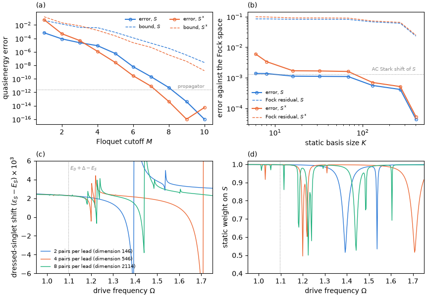

# Tutorial 05: numerical convergence of a driven calculation

## Goal

Check a Floquet calculation of the phase-driven reference junction in each of its independent
approximations:

- the Floquet cutoff $M$ for a strong drive, with the rigorous residual bound;
- the same quasienergies from the one-period propagator, which has no Floquet cutoff;
- the size $K$ of the static basis against the full QP Fock space, with the Fock-space residual;
- the bath discretization, by following the dressed singlet across the one-photon threshold of
  the continuum for several bath sizes.

## Physics in brief

The Sambe matrix couples the harmonic blocks $u_m$ of a Floquet state through the drive
harmonics $H_k$, and the calculation keeps $\lvert m\rvert\le M$. Let $\lambda$ be an
eigenvalue of the truncated matrix. Its eigenvector has a residual $r$ within the retained blocks
(the window residual, which measures the eigensolver accuracy) and a leakage $\ell$ into the
omitted blocks. Because the infinite Sambe operator is self-adjoint, an exact quasienergy lies
within

```math
\lvert\varepsilon-\lambda\rvert\le\sqrt{r^2+\ell^2}
```

of $\lambda$. This bound is reported as `residuals`. It is first order; for an isolated
quasienergy the actual error is typically of second order in $\ell$, much smaller than the
bound. The harmonics of a phase drive decay like Bessel functions $J_k(A/4)$, so the error
falls exponentially with $M$. The one-period propagator $U(T)$ has no Floquet cutoff at all:
its eigenphases give the quasienergies, and only the time step must be checked.

A static basis of the $K$ lowest undriven eigenstates retains the resonant couplings among these states,
but a weak drive also shifts each level by the AC Stark shift

```math
\delta\varepsilon_a=\sum_{(b,m)\ne(a,0)}\frac{\lvert\langle b\vert H_m\vert a\rangle\rvert^2}{E_a-E_b-m\Omega}.
```

The phase drive couples the subgap states to quasiparticle states at all energies up to the
bandwidth, and each adds a small term. These contributions are missing from a small static
basis; `fock_residuals` measures the residual of the static-basis result in the full Fock
space.

Above the one-photon threshold $\Omega>E_D+\Delta-E_S$, the drive can break the singlet into
the doublet and a quasiparticle in a lead: a replica of the dressed singlet lies in the
continuum. A finite bath replaces the continuum by discrete levels, whose replicas cross the
dressed singlet and produce narrow avoided crossings. Their positions depend on the
discretization; in the continuum limit they merge into a finite lifetime of the dressed state.

## Physics manual

<!-- BEGIN generated: physics-manual (tools/gen_docs.py) -->
The physics behind this tutorial is explained in the
[physics manual](../../docs/manual/README.md):

- chapter “Example: numerical convergence” (`ch:ex-numerics`)
- section “Sambe-space diagonalization” (`sec:sambe-method`)
- section “The one-period propagator” (`sec:propagator`)
- section “Floquet states coupled to a continuum” (`sec:continuum`)
<!-- END generated: physics-manual -->

## Run

From the repository root, after `python -m pip install '.[plots]'` (matplotlib is needed only
for the figure):

```sh
python -B examples/05_convergence/run.py                    # quick: 2 bath pairs, about 7 s
python -B examples/05_convergence/run.py --profile full     # the physics manual's junction, about 3 minutes
```

The junction is the reference junction of the physics manual, with energies in units of the gap
$\Delta$: $U=1$, $\Gamma=0.5$, $\epsilon=0.2$, $\phi_0=0.8$, half-bandwidth $D=10$, QP
cutoff 2, and phase drives of amplitude $A=1.5$ (strong) and $A=0.3$ (weak) at $\Omega=0.45$.
The full profile uses four bath level pairs per lead (Fock dimension 546 of the even sector), a
static basis of $K=68$ states for the cutoff study, static bases up to $K=404$, and baths of
two, four and eight level pairs with 321 drive frequencies. The quick profile uses two bath
level pairs per lead for the first three studies, and baths of two and four level pairs with 33
frequencies.
Results are written to `runs/examples/05_convergence/<profile>/`: `results.json` with the
numbers below and the data of the figure, and `convergence.png`.

## Expected results

<!-- BEGIN generated: expected-results (tools/gen_docs.py) -->
`python tools/check_tutorials.py 05_convergence` runs the quick profile and compares it with
[`reference/quick.json`](reference/quick.json); add `--profile full` for
[`reference/full.json`](reference/full.json).

| Quantity | Key | Quick profile | Full profile | Tolerance |
|---|---|---|---|---|
| Fock dimension of the even sector at QP cutoff 2 | `fock_dimension` | 146 | 546 | exact |
| Static singlet energy $E_S$ | `energy_S` | -0.827912 | -0.822154 | ±1e-09 |
| Static excited-singlet energy $E_{S^*}$ | `energy_Sstar` | -0.096921 | -0.106161 | ±1e-09 |
| Static basis size $K$ of the Floquet-cutoff study | `basis_states` | 20 | 68 | exact |
| Quasienergy of $S$ at $A=1.5$ with the reference cutoff | `strong_S` | -0.769199 | -0.763416 | ±1e-08 |
| Quasienergy of $S^*$ at $A=1.5$ with the reference cutoff | `strong_Sstar` | -0.102080 | -0.153805 | ±1e-08 |
| Smallest $M$ with both residual bounds below $10^{-6}$ | `converged_harmonics` | 9 | 9 | exact |
| Decrease of the error per harmonic, in decades, from $M=2$ to 7 | `decades_per_harmonic` | 1.51 | 1.28 | ±1e-03 |
| Largest ratio of the actual error to the residual bound | `max_error_over_bound` | at most 1e+00 | at most 1e+00 | upper bound |
| Distance of the propagator quasienergies from the Sambe reference | `propagator_deviation` | at most 1e-09 | at most 1e-09 | upper bound |
| Estimated time-step error of the propagator | `propagator_step_error` | at most 1e-09 | at most 1e-09 | upper bound |
| Fock-space quasienergy of $S$ at $A=0.3$ | `fock_S` | -0.826600 | -0.820872 | ±1e-09 |
| Fock-space quasienergy of $S^*$ at $A=0.3$ | `fock_Sstar` | -0.101083 | -0.112382 | ±1e-09 |
| AC Stark shift $\varepsilon_S-E_S$ in the Fock space | `stark_shift` | 0.001312 | 0.001282 | ±1e-09 |
| Static-basis error at $K\approx10$ | `basis_error_small` | 1.63e-03 | 3.37e-03 | ±1e-09 |
| Static-basis error at the largest $K$ below the Fock dimension | `basis_error_large` | 6.95e-05 | 5.36e-05 | ±1e-09 |
| Largest ratio of the static-basis error to the Fock-space residual | `max_error_over_fock_residual` | at most 1e+00 | at most 1e+00 | upper bound |
| One-photon threshold $E_D+\Delta-E_S$, four level pairs | `threshold` | 1.095788 | 1.095788 | ±1e-09 |
| AC Stark shift of $S$ at $\Omega=1$, two level pairs | `shift_below_2` | 0.002419 | 0.002419 | ±1e-09 |
| AC Stark shift of $S$ at $\Omega=1$, four level pairs | `shift_below_4` | 0.002394 | 0.002394 | ±1e-09 |
| AC Stark shift of $S$ at $\Omega=1$, eight level pairs | `shift_below_8` | – | 0.002382 | ±1e-09 |
| Smallest static weight of $S$ above the threshold, two level pairs | `min_weight_above_2` | 0.644 | 0.515 | ±1e-04 |
| Smallest static weight of $S$ above the threshold, four level pairs | `min_weight_above_4` | 0.495 | 0.495 | ±1e-04 |
| Smallest static weight of $S$ above the threshold, eight level pairs | `min_weight_above_8` | – | 0.500 | ±1e-04 |
<!-- END generated: expected-results -->

The quick profile uses a smaller bath, so most of its values differ from those of the full
profile; the numbers quoted below are those of the full profile.

The full profile reproduces the figure of chapter “Example: numerical convergence”
(`ch:ex-numerics`):



## What to look at

- **Panel (a), the Floquet cutoff.** The error falls by more than a decade per harmonic
  (`decades_per_harmonic`), down to rounding at $M=9$. The bound (dashed) always lies above the
  error (`max_error_over_bound` is below 1), and the error is roughly the square of the bound:
  at $M=6$ the bound is about $10^{-4}$ and the error about $10^{-8}$. Using the bound therefore requires
  a few more harmonics than the actual error would require (`converged_harmonics`), giving a conservative convergence criterion.
- **The propagator.** The one-period propagator in the same static basis agrees with the Sambe
  reference to $2\times10^{-12}$ (dotted line in panel (a)). This difference equals its own
  time-step estimate, so it is limited by the time steps of the fourth-order Magnus integrator
  and not by the Floquet cutoff.
- **Panel (b), the static basis.** The error is already about $10^{-3}$ for $K\approx10$, comparable
  to the AC Stark shift of $S$ itself (dotted line), and decreases only slowly until $K$
  approaches the Fock dimension. The far-off-resonant states that a small basis omits each
  contribute little, but together they shift $S$ by about $10^{-3}$. The Fock residual
  (dashed) exceeds the error by more than an order of magnitude: a rigorous but loose bound.
- **Panels (c, d), the bath.** The legend gives the Fock dimension of each bath. Below the
  threshold (dotted) the dressed singlet has nearly the same AC Stark shift for every bath,
  within about 1.5% at $\Omega=1$ (`shift_below_2` to `shift_below_8`). Above it, every bath
  shows narrow avoided crossings, at which the static weight of $S$ drops to about one half, at
  positions that differ from bath to bath. The few narrow dips below the threshold are
  two-photon resonances, $2\Omega=E_a-E_S$, with discrete continuum levels $a$.

## Try next

- Double the strong amplitude `STRONG` to 3 and extend `harmonics` in `PROFILES` to
  `range(1, 15)`. The harmonics of the drive decay more slowly, and the error reaches rounding
  only at $M\approx12$ instead of 9.
- Add `steps=64` to the options of `floquet_propagator` (the default is 256). The step error
  grows as the fourth power of the step, to about $6\times10^{-10}$, and
  `propagator_step_error` still matches the distance from the Sambe reference.
- Add a bath of six level pairs to `baths` in the full profile and check which features above
  the threshold move.
- Double `WEAK` to 0.6. The one-photon avoided crossings above the threshold widen in
  proportion to $A$, the two-photon ones below it in proportion to $A^2$.

## Files

| File | Content |
|---|---|
| [`run.py`](run.py) | The calculation: Floquet cutoff, propagator, static basis, bath sizes and the figure |
| [`reference/quick.json`](reference/quick.json), [`reference/full.json`](reference/full.json) | Expected values and tolerances |
| [`expected.png`](expected.png) | Figure of the full profile |

The script uses `solve_floquet` with `basis="eigen"` and a precomputed `static=` result, the
`residuals`, `boundary_weights`, `fock_residuals` and `static_weights` of `FloquetStates`,
`floquet_propagator` with the `step_errors` in its metadata, and
`dataclasses.replace(periodic, omega=...)` to scan the drive frequency without recomputing the
harmonics.

## See also

- [Floquet calculations](../../docs/floquet.md): the
  [methods](../../docs/floquet.md#methods) and
  [convergence and pitfalls](../../docs/floquet.md#convergence-and-pitfalls)
- [Numerical methods and convergence](../../docs/numerics.md#separate-approximations)
- [Option reference](../../docs/reference/options.md#floquet-calculations) and
  [result reference](../../docs/reference/results.md#floquet-states)
- [Tutorial 04](../04_high_frequency/README.md): the high-frequency limit
- The [tutorial index](../README.md)
