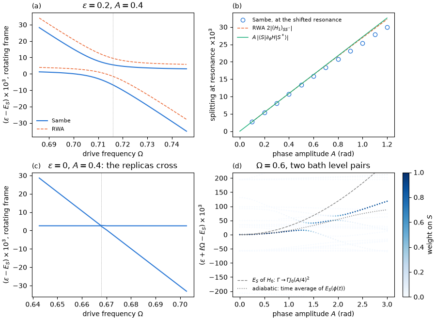

# Tutorial 06: the phase-driven junction

## Goal

Drive the superconducting phase difference of a quantum-dot Josephson junction with a
microwave tone, $\phi(t)=\phi_0+A\cos\Omega t$, and compute the dressed subgap states:

- the avoided crossing of the singlet ground state $S$ and the excited singlet $S^*$ near the
  one-photon resonance $\Omega\approx\omega_{SS^*}$, compared with the two-level rotating-wave
  approximation (RWA);
- the Rabi splitting at the resonance versus the drive amplitude, compared with the linear law
  $A\lvert\langle S\vert\partial_\phi H\vert S^*\rangle\rvert$;
- the eta selection rule: at the particle–hole-symmetric point the phase drive cannot couple
   $S$ and $S^*$, and their replicas cross without hybridizing;
- the Floquet spectrum versus the drive amplitude at a fixed frequency, and the shift of the
  dressed singlet.

## Physics in brief

The junction has $U=1$, $\Gamma=0.5$ (total hybridization), $\epsilon=0.2$, $\phi_0=0.8$ and
four bath level pairs per lead with half-bandwidth $D=10$, in units of the gap $\Delta=1$. Its
pair transition is at $\omega_{SS^*}=E_{S^*}-E_S=0.716$. The phase enters the tunnelling terms
as $e^{\pm i\phi/4}$ per lead, and the Jacobi–Anger expansion gives the harmonics of a phase
drive,

```math
H_0=H(\phi_0)\big\vert_{\Gamma\to\Gamma J_0(A/4)^2},\qquad
H_{\pm1}=4J_1(A/4)\,\frac{\partial H}{\partial\phi}\bigg\vert_{\phi_0}\approx\frac{A}{2}\,\frac{\partial H}{\partial\phi}.
```

In the rotating frame the quasienergies $\varepsilon_S$ and $\varepsilon_{S^*}-\Omega$ form an
avoided crossing. The two dressed states are split by $w(\Omega)=\sqrt{(\Omega-\Omega_r)^2+\delta^2}$,
with the Rabi splitting

```math
\delta=2\lvert(H_1)_{SS^*}\rvert=8J_1(A/4)\,\lvert\langle S\vert\partial_\phi H\vert S^*\rangle\rvert
\approx A\,\lvert\langle S\vert\partial_\phi H\vert S^*\rangle\rvert .
```

The two-level RWA keeps only $\vert S,0\rangle$ and $\vert S^*,-1\rangle$ and projects $H_0$ and
$H_{\pm1}$ onto them. The full Sambe calculation also contains the AC Stark shifts caused by all
other states.
Both the renormalized $H_0$ and the AC Stark shifts move the resonance $\Omega_r$ away from
$\omega_{SS^*}$. The script finds $\Omega_r$ and $\delta$ by fitting the parabola $w^2(\Omega)$.

At $\epsilon=0$ the states $S$ and $S^*$ have opposite eta parity. The phase drive conserves
eta parity, so $\langle S\vert\partial_\phi H\vert S^*\rangle=0$ and no splitting opens at any
amplitude. The gate drive, proportional to $n_d-1$, is eta-odd and couples the pair; its
matrix element is largest there ([tutorial 07](../07_gate_drive/README.md)).

Away from resonances the dressed singlet shifts by two contributions of order $A^2$. The
time-averaged Hamiltonian $H_0$ has a weaker hybridization, which raises $E_S$. The AC
Stark shift, evaluated with the eigenstates and energies of $H_0$,

```math
\delta\varepsilon_S=\sum_{(b,m)\ne(S,0)}\frac{\lvert\langle b\vert H_m\vert S\rangle\rvert^2}{E_S-E_b-m\Omega}
```

lowers it when all states $b$ lie more than $\Omega$ above $S$, as for $\Omega=0.6$ here. For a
slow drive the sum of the two tends to the time average of the instantaneous energy,
$\overline{E_S(\phi(t))}\simeq E_S+\tfrac{A^2}{4}E_S''(\phi_0)$.

## Physics manual

<!-- BEGIN generated: physics-manual (tools/gen_docs.py) -->
The physics behind this tutorial is explained in the
[physics manual](../../docs/manual/README.md):

- chapter “Example: the phase-driven junction” (`ch:ex-phase`)
- section “Harmonics of the phase drive” (`sec:jacobi-anger`)
- section “Selection rules” (`sec:selection`)
- section “The rotating-wave model” (`sec:rwa`)
- section “Regimes” (`sec:regimes`)
<!-- END generated: physics-manual -->

## Run

From the repository root, after `python -m pip install '.[plots]'` (matplotlib is needed only
for the figure):

```sh
python -B examples/06_phase_drive/run.py                    # quick: about 15 s
python -B examples/06_phase_drive/run.py --profile full     # the complete scans, about 3.5 minutes
```

Both profiles use the same junctions and the Floquet cutoff $M=4$. The resonance is computed
with four bath level pairs per lead in the full Fock space at QP cutoff 2 (546 even states). The
Floquet spectrum uses two level pairs per lead (146 even states), and all its Floquet states are
computed. The quick profile evaluates the frequency sweeps on coarse grids and the amplitude
scans only at $A=1$, so its numbers coincide with those of the full profile. The full profile
scans 41 frequencies, the amplitudes from $A=0.1$ to $A=1.2$ for the splitting and 61 amplitudes
from $A=0$ to $A=3$ for the spectrum. Results are written to
`runs/examples/06_phase_drive/<profile>/`: `results.json` with the numbers below and all
curves, and `phase_drive.png`.

## Expected results

<!-- BEGIN generated: expected-results (tools/gen_docs.py) -->
`python tools/check_tutorials.py 06_phase_drive` runs the quick profile and compares it with
[`reference/quick.json`](reference/quick.json); add `--profile full` for
[`reference/full.json`](reference/full.json).

| Quantity | Key | Quick profile | Full profile | Tolerance |
|---|---|---|---|---|
| Pair transition energy $E_{S^*}-E_S$ | `omega0` | 0.715993 | 0.715993 | ±1e-09 |
| Current matrix element $\lvert\langle S\vert\partial_\phi H\vert S^*\rangle\rvert$ | `element` | 0.027152 | 0.027152 | ±1e-09 |
| RWA splitting $2\lvert(H_1)_{SS^*}\rvert$ at $A=0.4$ | `rwa_splitting` | 0.010847 | 0.010847 | ±1e-09 |
| Linear law $A\lvert\langle S\vert\partial_\phi H\vert S^*\rangle\rvert$ at $A=0.4$ | `linear_splitting` | 0.010861 | 0.010861 | ±1e-09 |
| RWA resonance frequency at $A=0.4$ | `rwa_resonance` | 0.714164 | 0.714164 | ±1e-08 |
| Sambe resonance frequency $\Omega_r$ at $A=0.4$ | `resonance_omega` | 0.710266 | 0.710266 | ±1e-06 |
| Resonance shift $\Omega_r-\omega_{SS^*}$ at $A=0.4$ | `resonance_shift` | -0.005727 | -0.005727 | ±1e-06 |
| Sambe splitting $\delta$ at the resonance, $A=0.4$ | `splitting` | 0.010737 | 0.010737 | ±1e-07 |
| Sambe splitting at $A=1$ over the linear law | `strong_linear_ratio` | 0.9328 | 0.9328 | ±1e-05 |
| RWA splitting at $A=1$ over the linear law, $8J_1(1/4)$ | `strong_rwa_ratio` | 0.9922 | 0.9922 | ±1e-08 |
| Resonance shift $\Omega_r-\omega_{SS^*}$ at $A=1$ | `strong_resonance_shift` | -0.0299 | -0.0299 | ±1e-05 |
| Pair transition energy at $\epsilon=0$ | `symmetric_omega0` | 0.672601 | 0.672601 | ±1e-09 |
| Current matrix element at $\epsilon=0$ (eta selection rule) | `symmetric_element` | at most 1e-12 | at most 1e-12 | upper bound |
| Charge matrix element $\lvert\langle S\vert n_d\vert S^*\rangle\rvert$ at $\epsilon=0$ | `symmetric_charge_element` | 0.651576 | 0.651576 | ±1e-09 |
| RWA coupling at $\epsilon=0$, $A=0.4$ | `symmetric_rwa_coupling` | at most 1e-12 | at most 1e-12 | upper bound |
| Largest weight of $S^*$ in the dressed $S$, or of $S$ in the dressed $S^*$, at $\epsilon=0$ | `symmetric_mixing` | at most 1e-12 | at most 1e-12 | upper bound |
| Frequency at which the replicas cross at $\epsilon=0$, $A=0.4$ | `symmetric_crossing` | 0.667853 | 0.667853 | ±1e-07 |
| Pair transition energy with two bath level pairs per lead | `fan_omega0` | 0.730991 | 0.730991 | ±1e-09 |
| Hybridization factor $J_0(A/4)^2$ of $H_0$ at $A=1$ | `hybridization_factor` | 0.9691 | 0.9691 | ±1e-12 |
| Dressed-singlet shift $\varepsilon_S-E_S$ at $A=1$, $\Omega=0.6$ (two bath level pairs) | `dressed_shift` | 0.01219 | 0.01219 | ±1e-08 |
| Shift of $E_S$ in the time-averaged $H_0$ at $A=1$ | `averaged_shift` | 0.03033 | 0.03033 | ±1e-09 |
| Difference of $E_S$ between $H_0$ and the junction with $\Gamma J_0(A/4)^2$ | `averaged_check` | at most 1e-12 | at most 1e-12 | upper bound |
| AC Stark part of the dressed-singlet shift at $A=1$ | `ac_stark_shift` | -0.01815 | -0.01815 | ±1e-08 |
| Adiabatic estimate $\overline{E_S(\phi(t))}-E_S$ at $A=1$ | `adiabatic_shift` | 0.01489 | 0.01489 | ±1e-09 |
| Amplitude of the first avoided crossing of the dressed singlet at $\Omega=0.6$ | `fan_crossing` | – | 1.40 | ±1e-09 |
<!-- END generated: expected-results -->

The full profile gives this figure:



## What to look at

- **Panel (a), the avoided crossing.** At $A=0.4$ the Sambe solution and the RWA have nearly
  the same splitting, $\delta=0.01074$ compared with the RWA splitting $0.01085$, but the Sambe pair
  lies lower. Its resonance is at $\Omega_r=0.7103$, $5.7\times10^{-3}$ below
  $\omega_{SS^*}=0.7160$. The RWA resonance, $0.7142$, contains only the part of this shift that
  comes from the renormalized $H_0$. The rest is the AC Stark shift caused by the other states,
  mostly quasiparticle states of the leads, which the two-level RWA omits.
- **Panel (b), splitting versus amplitude.** The RWA splitting,
  $8J_1(A/4)\lvert\langle S\vert\partial_\phi H\vert S^*\rangle\rvert$, stays within 1% of the
  linear law up to $A=1$. The Sambe splitting falls progressively below it: by 1% at $A=0.4$,
  2.5% at $A=0.6$ and 7% at $A=1$, where the resonance has moved down by $0.030$. At $A=1$ the
  two dressed states retain only about 92% of their weight on $S$ and $S^*$; the rest is in
  continuum states, which reduces the effective coupling. The splitting must be measured at the shifted
  resonance: at the fixed frequency $\omega_{SS^*}$, or in a frequency window that misses
  $\Omega_r$, the pair is detuned and the apparent splitting is too large.
- **Panel (c), the selection rule.** At $\epsilon=0$ the matrix element, the RWA coupling and
  the mixing of the dressed states vanish to rounding error. The rotating-frame lines cross
  at $\Omega=0.668$, below $\omega_{SS^*}=0.673$ of this junction because of the renormalized
  $H_0$ and the AC Stark shifts. The charge matrix element of the same pair is $0.652$.
- **Panel (d), the spectrum versus amplitude.** At $\Omega=0.6$ each point is a replica
  $\varepsilon+\ell\Omega$ near $E_S$, coloured by its time-averaged weight on $S$. The dark
  line is the dressed singlet; the light lines are replicas $E_b-\ell\Omega$, $\ell>0$, of
  higher states $b$. The dressed singlet rises roughly as $A^2$: by $12.2\times10^{-3}$ at
  $A=1$. The time-averaged Hamiltonian alone (dashed) would raise it by $30.3\times10^{-3}$.
  The AC Stark shift, $-18.1\times10^{-3}$, cancels more than half of this, and the result is
  close to the adiabatic estimate (dotted, $14.9\times10^{-3}$). Near $A=1.4$ the dressed
  singlet hybridizes with a replica that the growing shift has brought into resonance, and it
  loses weight.

## Try next

- Change `"detuning"` in `JUNCTION` to `0.05` or `0.4` and watch the splitting follow the
  matrix element, which grows away from $\epsilon=0$
  ([tutorial 07](../07_gate_drive/README.md) scans the operating point).
- Raise `HARMONICS` to 5 or 8 and check that the splitting at $A=1$ changes by less than
  $10^{-7}$; it changes by about $2\times10^{-8}$, the accuracy of the parabola fit. Near the
  resonance, the shift-invert solver then needs more eigenpairs per target to find both dressed
  states; it increases this number automatically (`metadata["eigenpairs_per_target"]`).
- Scan $w(\Omega)$ on a fine grid around $\Omega_r$ at $A=1$ instead of fitting the parabola.
  Narrow avoided crossings with replicas of discrete continuum levels make the curve jagged: it
  dips to about $0.0248$ near $\Omega=0.684$, while the fit over $\pm\delta$ gives $0.0253$.
  Such features depend on the bath discretization.
- Locate the two-photon resonance with `resonance(drive, static, omega0/2, 1e-3)`. Its
  splitting grows as $A^2$, to about $0.012$ at $A=1$. It is mediated by the even harmonics,
  which are proportional to the tunnelling term rather than to the current, and by virtual
  transitions through other states.
- Lower `FAN_OMEGA` to `0.1`, raise the Floquet cutoff `HARMONICS` (and the option
  `dense_dimension` of `solve_floquet`, the largest Sambe matrix diagonalized densely) and compare
  the dressed singlet with the adiabatic curve, as in the chapter “Example: the phase-driven
  junction” (`ch:ex-phase`).
- Compute the spectrum with three bath level pairs per lead in a static basis
  (`basis="eigen"`, `basis_states` at a gap of the static spectrum) and see which lines move:
  replicas of continuum states depend on the discretization.

## Files

| File | Content |
|---|---|
| [`run.py`](run.py) | The calculation: static junctions, Sambe and RWA solutions, resonance fits and the figure |
| [`reference/quick.json`](reference/quick.json), [`reference/full.json`](reference/full.json) | Expected values and tolerances |
| [`expected.png`](expected.png) | Figure of the full profile |

The script uses `PeriodicHamiltonian.from_parameters` with `ParameterDrive.cosine("phi", A)`,
`solve_floquet` in the Fock space, both for the two Floquet states that continue $S$ and $S^*$
(`states=2`, `method="shift-invert"`) and for all Floquet states (`selection="all"`,
`method="dense"`), `rwa_model` and its `effective_matrix`, `Eigenstates.matrix_elements("current")`
and `("charge")` for the static matrix elements, and `PeriodicHamiltonian.time_average()`.

## See also

- [Floquet calculations](../../docs/floquet.md): drives, the phase drive and voltage, methods,
  the rotating-wave model and convergence
- [Physical models and conventions](../../docs/models.md): the reference junction and its observables
- [Option reference](../../docs/reference/options.md#floquet-calculations) and
  [result reference](../../docs/reference/results.md#floquet-states)
- The [tutorial index](../README.md)
