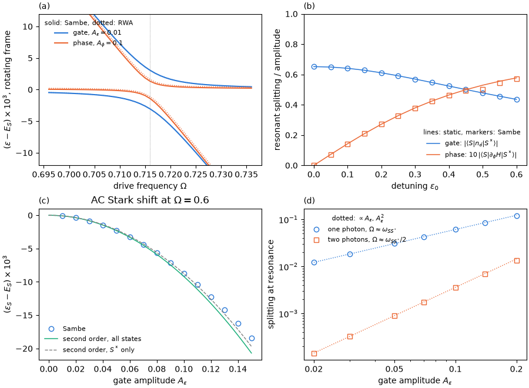

# Tutorial 07: the gate-driven junction

## Goal

Drive the dot level of a quantum-dot Josephson junction with a microwave gate voltage,
$\epsilon(t)=\epsilon_0+A_\epsilon\cos\Omega t$, and compare the resulting resonances with those of a phase drive:

- the resonance of the pair transition between the singlet ground state $S$ and the excited
  singlet $S^*$, with the Rabi splitting $A_\epsilon\lvert\langle S\vert n_d\vert S^*\rangle\rvert$,
  next to the narrower resonance of a phase drive;
- the resonant splittings of both drives versus the operating point, the static detuning
  $\epsilon_0$: the eta selection rule makes them complementary;
- the AC Stark shift of the dressed singlet below the resonance, compared with second-order
  perturbation theory;
- the one- and two-photon splittings versus the drive amplitude.

## Physics in brief

The junction has $U=1$, $\Gamma=0.5$ (total hybridization), $\phi=0.8$ and four bath level
pairs per lead with half-bandwidth $D=10$, in units of the gap $\Delta=1$. At the operating
point $\epsilon_0=0.2$ the pair transition is at $\omega_{SS^*}=E_{S^*}-E_S=0.716$. The dot
Hamiltonian is linear in $\epsilon$, so under a gate drive

```math
H(t)=H(\epsilon_0)+A_\epsilon\cos(\Omega t)\,(n_d-1),\qquad
H_0=H(\epsilon_0),\qquad H_{\pm1}=\frac{A_\epsilon}{2}\,(n_d-1).
```

Unlike a phase drive, the gate drive leaves the time-averaged Hamiltonian unchanged. At the
one-photon resonance the rotating-wave splitting is
$\delta=A_\epsilon\lvert\langle S\vert n_d\vert S^*\rangle\rvert$, without Bessel-function
corrections. A weak phase drive gives
$\delta=A_\phi\lvert\langle S\vert\partial_\phi H\vert S^*\rangle\rvert$. The script finds the
resonance $\Omega_r$ and the splitting $\delta$ by fitting the parabola
$w^2(\Omega)=n^2(\Omega-\Omega_r)^2+\delta^2$, where $w$ is the splitting of the dressed pair
near an $n$-photon resonance.

The two drives obey complementary selection rules. At the particle–hole-symmetric point
$\epsilon_0=0$ the states $S$ and $S^*$ have opposite eta parity. The phase drive is eta-even
and cannot couple them. The gate drive, proportional to $n_d-1$, is eta-odd and couples them;
its matrix element is largest there. Away from $\epsilon_0=0$ both drives couple the pair.

Below the resonance the AC Stark shift lowers the dressed-singlet energy. Because
$H_0=H(\epsilon_0)$, the time-averaged Hamiltonian does not shift $E_S$, and to second order
in $A_\epsilon$ the whole shift is the AC Stark shift:

```math
\delta\varepsilon_S\simeq-\frac{A_\epsilon^2}{4}\sum_{b\ne S}\lvert\langle S\vert n_d\vert b\rangle\rvert^2
\left(\frac{1}{E_b-E_S-\Omega}+\frac{1}{E_b-E_S+\Omega}\right),
```

with rotating and counter-rotating terms. The sum runs over all states of the sector; the
term $b=S^*$ dominates near the resonance. At $\Omega\approx\omega_{SS^*}/2$ two photons drive
the pair transition, and the splitting grows as $A_\epsilon^2$, as expected for a second-order process.
Two mechanisms contribute: virtual transitions through other states, and the difference of
the average charges of $S$ and $S^*$, which modulates their splitting, as in the Bessel-modulated
resonances of [tutorial 03](../03_two_level_system/README.md).

## Physics manual

<!-- BEGIN generated: physics-manual (tools/gen_docs.py) -->
The physics behind this tutorial is explained in the
[physics manual](../../docs/manual/README.md):

- chapter “Example: the gate-driven junction” (`ch:ex-gate`)
- section “Selection rules” (`sec:selection`)
- section “Regimes” (`sec:regimes`)
- section “The rotating-wave model” (`sec:rwa`)
<!-- END generated: physics-manual -->

## Run

From the repository root, after `python -m pip install '.[plots]'` (matplotlib is needed only
for the figure):

```sh
python -B examples/07_gate_drive/run.py                    # quick: about 15 s
python -B examples/07_gate_drive/run.py --profile full     # the complete scans, under 2 minutes
```

All calculations use the full Fock space of the junction at QP cutoff 2 (546 even states) and
the Floquet cutoff $M=4$, with drive amplitudes $A_\epsilon=0.01$ and $A_\phi=0.1$ for the
resonances. The quick profile evaluates the operating points $\epsilon_0=0$ and $0.2$, the AC
Stark shift at $A_\epsilon=0.05$ and the photon resonances at $A_\epsilon=0.1$, so its numbers
coincide with those of the full profile. The full profile scans 41 frequencies, 13 operating
points from $\epsilon_0=0$ to $0.6$, gate amplitudes up to $0.15$ for the AC Stark shift and
from $0.02$ to $0.2$ for the photon resonances. The spectrum is symmetric under
$\epsilon_0\to-\epsilon_0$, so only $\epsilon_0\ge0$ is computed. Results are written to `runs/examples/07_gate_drive/<profile>/`:
`results.json` with the numbers below and all curves, and `gate_drive.png`.

## Expected results

<!-- BEGIN generated: expected-results (tools/gen_docs.py) -->
`python tools/check_tutorials.py 07_gate_drive` runs the quick profile and compares it with
[`reference/quick.json`](reference/quick.json); add `--profile full` for
[`reference/full.json`](reference/full.json).

| Quantity | Key | Quick profile | Full profile | Tolerance |
|---|---|---|---|---|
| Pair transition energy $E_{S^*}-E_S$ | `omega0` | 0.715993 | 0.715993 | ±1e-09 |
| Charge matrix element $\lvert\langle S\vert n_d\vert S^*\rangle\rvert$ | `charge_element` | 0.610897 | 0.610897 | ±1e-09 |
| Current matrix element $\lvert\langle S\vert\partial_\phi H\vert S^*\rangle\rvert$ | `current_element` | 0.027152 | 0.027152 | ±1e-09 |
| Ratio of the charge and current matrix elements | `element_ratio` | 22.499 | 22.499 | ±1e-06 |
| Gate resonance $\Omega_r$ at $A_\epsilon=0.01$ | `gate_resonance` | 0.716007 | 0.716007 | ±1e-06 |
| Gate splitting at the resonance, $A_\epsilon=0.01$ | `gate_splitting` | 0.006109 | 0.006109 | ±1e-08 |
| Gate splitting over $A_\epsilon\lvert\langle S\vert n_d\vert S^*\rangle\rvert$ | `gate_ratio` | 0.99995 | 0.99995 | ±1e-06 |
| Phase resonance $\Omega_r$ at $A_\phi=0.1$ | `phase_resonance` | 0.715621 | 0.715621 | ±1e-06 |
| Phase splitting at the resonance, $A_\phi=0.1$ | `phase_splitting` | 0.002713 | 0.002713 | ±1e-08 |
| Phase splitting over $A_\phi\lvert\langle S\vert\partial_\phi H\vert S^*\rangle\rvert$ | `phase_ratio` | 0.99927 | 0.99927 | ±1e-05 |
| Charge matrix element at $\epsilon_0=0$ | `symmetric_charge_element` | 0.651576 | 0.651576 | ±1e-09 |
| Current matrix element at $\epsilon_0=0$ (eta selection rule) | `symmetric_current_element` | at most 1e-12 | at most 1e-12 | upper bound |
| Gate splitting per amplitude at $\epsilon_0=0$ | `symmetric_gate_per_amplitude` | 0.65149 | 0.65149 | ±1e-06 |
| Phase splitting per amplitude at $\epsilon_0=0$ | `symmetric_phase_per_amplitude` | at most 1e-05 | at most 1e-05 | upper bound |
| Shift of $E_S$ in the time-averaged gate-driven $H_0$ | `averaged_shift` | at most 1e-12 | at most 1e-12 | upper bound |
| AC Stark shift at $A_\epsilon=0.05$, $\Omega=0.6$ (Sambe) | `stark_sambe` | -0.002264 | -0.002264 | ±1e-09 |
| Second-order AC Stark shift, all states | `stark_second_order` | -0.002299 | -0.002299 | ±1e-10 |
| Second-order AC Stark shift, $S^*$ term only | `stark_pair_only` | -0.002188 | -0.002188 | ±1e-10 |
| One-photon splitting at $A_\epsilon=0.1$ | `one_photon_strong` | 0.06081 | 0.06081 | ±1e-07 |
| Two-photon splitting at $A_\epsilon=0.1$ | `two_photon_strong` | 0.003543 | 0.003543 | ±1e-08 |
| Two-photon resonance frequency at $A_\epsilon=0.1$ | `two_photon_resonance` | 0.36098 | 0.36098 | ±1e-06 |
| Largest deviation of the gate splitting per amplitude from the charge matrix element, over $\epsilon_0$ | `gate_max_deviation` | – | at most 2e-04 | upper bound |
| Phase splitting over the linear law at $\epsilon_0=0.5$ | `phase_ratio_05` | – | 0.9450 | ±1e-05 |
| Phase splitting over the linear law at $\epsilon_0=0.6$ | `phase_ratio_06` | – | 0.9931 | ±1e-05 |
| Exponent of the one-photon splitting versus $A_\epsilon$, fitted for $A_\epsilon\le0.1$ | `one_photon_exponent` | – | 0.9974 | ±1e-05 |
| Exponent of the two-photon splitting versus $A_\epsilon$, fitted for $A_\epsilon\le0.1$ | `two_photon_exponent` | – | 1.9918 | ±1e-05 |
<!-- END generated: expected-results -->

The full profile gives this figure:



## What to look at

- **Panel (a), two resonances.** A gate amplitude $A_\epsilon=0.01$ splits the pair by
  $6.1\times10^{-3}$, more than twice the splitting of a phase drive with $A_\phi=0.1$ rad
  ($2.7\times10^{-3}$): the charge matrix element is 22.5 times larger than the current matrix
  element. The gate resonance stays at $\omega_{SS^*}$ (shift $1.4\times10^{-5}$), whereas the
  phase resonance moves by $-3.7\times10^{-4}$: the phase drive renormalizes $H_0$ and has
  larger AC Stark shifts. The RWA (dotted) agrees closely with the Sambe solution for these weak
  drives.
- **Panel (b), the operating point.** Splitting per amplitude (markers) and static matrix
  elements (lines); the phase-drive values are multiplied by 10. The gate-drive splitting is
  largest at $\epsilon_0=0$ and agrees with $\lvert\langle S\vert n_d\vert S^*\rangle\rvert$ to
  better than $10^{-4}$ everywhere. The phase-drive splitting vanishes at $\epsilon_0=0$, where
  the replicas cross, and grows linearly away from it. Near $\epsilon_0=0.5$ the phase-drive
  splitting falls 5% below the static element and the resonance moves by $-2.8\times10^{-3}$.
  There $S^*$ plus one photon is nearly resonant with a discrete continuum level $b$ of the
  finite bath, $E_b-E_{S^*}\approx\omega_{SS^*}+0.018$, which the current operator couples to
  $S^*$. Such features move with the bath discretization.
- **Panel (c), the AC Stark shift.** At $\Omega=0.6$ the dressed singlet moves down as
  $A_\epsilon^2$. At $A_\epsilon=0.05$ the Sambe shift is $-2.264\times10^{-3}$, second-order
  perturbation theory over all 546 states gives $-2.299\times10^{-3}$, and the $S^*$ term alone
  $-2.188\times10^{-3}$. The difference between Sambe and second order is of fourth order and
  grows as $A_\epsilon^4$. The time-averaged Hamiltonian is not shifted at all.
- **Panel (d), one and two photons.** The one-photon splitting grows linearly with
  $A_\epsilon$ and the two-photon splitting quadratically (fitted exponents 0.997 and 1.992 for
  $A_\epsilon\le0.1$). The two-photon resonance moves upwards with the amplitude, from
  $\omega_{SS^*}/2=0.358$ to $0.361$ at $A_\epsilon=0.1$, by AC Stark and Bloch–Siegert shifts.

## Try next

- Set `STARK_OMEGA` to `0.7`, closer to the resonance, and watch the second-order formula fail
  at smaller amplitudes.
- In step 4 of `main()`, replace the gate drive by a phase drive,
  `drive(model, "phase", A, STARK_OMEGA)`. Its time average now shifts $E_S$
  ([tutorial 06](../06_phase_drive/README.md)): compare `time_average()` with the undriven junction.
- Change `"phi"` in `JUNCTION` to `3.0`, near $\phi=\pi$, where the gap between $S$ and $S^*$
  is smallest, and compare the two matrix elements.
- Raise `HARMONICS` to 6 and check that the two-photon splitting changes by less than
  $10^{-8}$; the two-photon process needs $M\ge2$ to contain the intermediate replica.
- Drive the gate and the phase together with a relative phase (a list of two
  `ParameterDrive` objects) and look for interference of the two couplings.

## Files

| File | Content |
|---|---|
| [`run.py`](run.py) | The calculation: static junctions, Sambe and RWA solutions, resonance fits, perturbation theory and the figure |
| [`reference/quick.json`](reference/quick.json), [`reference/full.json`](reference/full.json) | Expected values and tolerances |
| [`expected.png`](expected.png) | Figure of the full profile |

The script uses `PeriodicHamiltonian.from_parameters` with `ParameterDrive.cosine("detuning", A)`
and `ParameterDrive.cosine("phi", A)`, `solve_floquet` in the Fock space for the Floquet states
that continue $S$ and $S^*$ (`method="shift-invert"`), `rwa_model` and its `effective_matrix`,
`Eigenstates.matrix_elements("charge")` and `("current")` for the static matrix elements, and
`PeriodicHamiltonian.time_average()`.

## See also

- [Floquet calculations](../../docs/floquet.md): drives, methods, the rotating-wave model and
  convergence
- [Physical models and conventions](../../docs/models.md): the reference junction, the detuning
  and the observables
- [Option reference](../../docs/reference/options.md#floquet-calculations) and
  [result reference](../../docs/reference/results.md#floquet-states)
- The [tutorial index](../README.md)
