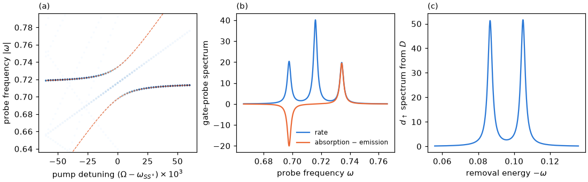

# Tutorial 08: two-tone spectroscopy of the pair transition

## Goal

Pump the transition between the singlet ground state $S$ and the excited singlet $S^*$ of
a quantum-dot Josephson junction with a microwave gate tone, and compute what a second,
weak probe measures:

- the probe lines of the dressed states as the pump is detuned from resonance, compared with
  the rotating-wave approximation (RWA);
- the Mollow pattern of absorption, stimulated emission and elastic lines at resonance;
- the Autler–Townes doublet seen by a tunnelling probe from the doublet $D$.

## Physics in brief

The junction has $U=1$, $\Gamma=0.5$ (total hybridization), $\epsilon_0=0.2$, $\phi=0.8$ and
four bath level pairs per lead with half-bandwidth $10$, in units of the gap $\Delta=1$. Its
pair transition is at $\omega_{SS^*}=E_{S^*}-E_S=0.716$. A gate pump
$\epsilon(t)=\epsilon_0+A_\epsilon\cos\Omega t$ with $A_\epsilon=0.03$ and $\Omega\approx\omega_{SS^*}$
mixes $S$ and $S^*$ into two dressed states. At resonance their splitting is the Rabi splitting
$\delta=A_\epsilon\lvert\langle S\vert n_d\vert S^*\rangle\rvert=0.0183$
([tutorial 07](../07_gate_drive/README.md)). Away from resonance the splitting grows as
$w=\sqrt{(\Omega-\omega_{SS^*})^2+\delta^2}$, and the two strongest probe lines lie at
$\Omega\pm w$.

A weak probe $X$ drives transitions from a Floquet state $\beta$ to a Floquet state $\alpha$ at
the probe frequencies $\omega=\varepsilon_\alpha-\varepsilon_\beta+q\Omega$, with strengths
$\lvert X^{(q)}_{\alpha\beta}\rvert^2$ (the Floquet golden rule); a negative frequency means
stimulated emission into the probe. At resonance, probing the pumped transition itself,
with the system initially in one dressed state, gives four lines with $\lvert\omega\rvert$ near the pump
frequency: absorption at $\Omega+\delta$, stimulated emission at $\Omega-\delta$, and elastic
lines at $\pm\Omega$. In the RWA each carries a quarter of the static strength
$\lvert\langle S\vert n_d\vert S^*\rangle\rvert^2$. This is the Mollow pattern; in the rate
spectrum the two elastic lines merge into the central line of the Mollow triplet. A spectator
transition, from $D$ into the dressed singlets, splits instead into two lines separated by
$\delta$, each with half of the static weight: the Autler–Townes doublet.

## Physics manual

<!-- BEGIN generated: physics-manual (tools/gen_docs.py) -->
The physics behind this tutorial is explained in the
[physics manual](../../docs/manual/README.md):

- chapter “Example: two-tone spectroscopy of the pair transition” (`ch:ex-twotone`)
- chapter “Probing the driven junction” (`ch:probes`)
- section “Mollow triplet and Autler–Townes doublet” (`sec:mollow`)
<!-- END generated: physics-manual -->

## Run

From the repository root, after `python -m pip install '.[plots]'` (matplotlib is needed only
for the figure):

```sh
python -B examples/08_two_tone/run.py                    # quick: two bath level pairs, 9 detunings, about 3 s
python -B examples/08_two_tone/run.py --profile full     # the physics manual's junction, about a minute
```

The full profile uses the junction above, the static basis of $K=43$ states, the Floquet
cutoff $M=6$ and 61 pump detunings. The quick profile uses two bath level pairs per lead,
$K=20$, $M=5$ and 9 detunings. The smaller bath shifts $\omega_{SS^*}$ to $0.731$ and changes
the other numbers slightly, so the two profiles have different expected values. Results are
written to `runs/examples/08_two_tone/<profile>/`: `results.json` with the numbers below and the
lines, and `two_tone.png`.

## Expected results

<!-- BEGIN generated: expected-results (tools/gen_docs.py) -->
`python tools/check_tutorials.py 08_two_tone` runs the quick profile and compares it with
[`reference/quick.json`](reference/quick.json); add `--profile full` for
[`reference/full.json`](reference/full.json).

| Quantity | Key | Quick profile | Full profile | Tolerance |
|---|---|---|---|---|
| Pair transition energy $E_{S^*}-E_S$ | `omega0` | 0.730991 | 0.715993 | ±1e-09 |
| Charge matrix element $\lvert\langle S\vert n_d\vert S^*\rangle\rvert$ | `element` | 0.601984 | 0.610897 | ±1e-08 |
| RWA splitting $\delta=A_\epsilon\lvert\langle S\vert n_d\vert S^*\rangle\rvert$ | `rabi` | 0.018060 | 0.018327 | ±1e-09 |
| Static basis size $K$ | `basis_states` | 20 | 43 | exact |
| Undriven removal line $E_D-E_S$ | `removal_energy` | 0.106319 | 0.095788 | ±1e-09 |
| Largest distance of the dominant dressed line from the RWA lines $\Omega\pm w$ | `rwa_deviation` | at most 5e-04 | at most 5e-04 | upper bound |
| Half separation of the Mollow sidebands | `mollow_splitting` | 0.018056 | 0.018319 | ±1e-06 |
| Emission sideband at $\Omega-\delta$, in units of the RWA value | `mollow_lower` | 1.0006 | 1.0152 | ±1e-04 |
| Elastic line at $\Omega$, in units of the RWA value | `mollow_central` | 1.0424 | 1.0083 | ±1e-04 |
| Absorption sideband at $\Omega+\delta$, in units of the RWA value | `mollow_upper` | 0.9999 | 0.9860 | ±1e-04 |
| Autler–Townes splitting of the removal line | `autler_townes_splitting` | 0.018056 | 0.018319 | ±1e-06 |
| Total Autler–Townes weight, in units of the static line | `autler_townes_weight` | 0.9999 | 0.9999 | ±1e-04 |
<!-- END generated: expected-results -->

The full profile gives this figure, a version of the figure in the physics manual's two-tone
chapter:



## What to look at

- **Panel (a).** The two dominant lines avoid each other at resonance and follow $\Omega\pm w$
  (dashed). Far from resonance the strong line returns to the bare transition $\omega_{SS^*}$,
  and the other one, a three-photon process, fades. The faint diagonal is the elastic line at
  $\lvert\omega\rvert=\Omega$; the other faint lines are transitions into the discretized
  continuum.
- **Panel (b).** In the rate spectrum the elastic lines at $\pm\Omega$ add up, so the central
  line of the Mollow triplet is twice as strong as the sidebands. In the net spectrum
  (absorption minus emission) the elastic lines cancel and the lower sideband is negative: the
  dressed system amplifies a probe there.
- **Panel (c).** The removal line from $D$, at $E_D-E_S=0.096$ without the pump, splits into
  two lines separated by $0.01832$, which agrees with $\delta$ to $10^{-5}$. The two dressed
  singlets share the weight equally.
- **Beyond the RWA.** The computed Mollow strengths are 1.015 (emission), 1.008 (each elastic
  line) and 0.986 (absorption) times the RWA value. Counter-rotating terms and the other states
  cause these deviations.

## Try next

- Halve the pump amplitude `PUMP` and check that $\delta$ and the Autler–Townes splitting
  halve.
- Probe with `"current"` instead of `"charge"`. At $\epsilon_0=0.2$ the current matrix element
  of the pair transition is small, and the strongest lines are continuum transitions and a
  low-frequency line at $\delta$ between the two dressed states.
- Pump the phase instead of the gate (`ParameterDrive.cosine("phi", ...)`), which couples
  through $\partial H/\partial\phi$.
- In step 3, start the lines from the other dressed state, `initial=even.dressed_state(1)`, and
  watch absorption and emission swap.

## Files

| File | Content |
|---|---|
| [`run.py`](run.py) | The calculation: static junction, Floquet states, probe lines and the figure |
| [`reference/quick.json`](reference/quick.json), [`reference/full.json`](reference/full.json) | Expected values and tolerances |
| [`expected.png`](expected.png) | Figure of the full profile |

The script uses `PeriodicHamiltonian.from_parameters` with a `ParameterDrive` of the detuning,
`solve_floquet` with `selection="all"` in the static eigenbasis (`basis="eigen"`),
`FloquetStates.matrix_elements` for the probes, `FloquetTransitions.lines` for transitions from
`dressed_state(0)`, and `line_shape` to broaden the lines for the figure, as
`SpectralLines.spectrum` does.

## See also

- [Floquet calculations](../../docs/floquet.md): drives, methods, and transitions and spectra
- [Option reference](../../docs/reference/options.md#floquet-calculations) and
  [result reference](../../docs/reference/results.md#probe-matrix-elements)
- The [tutorial index](../README.md)
