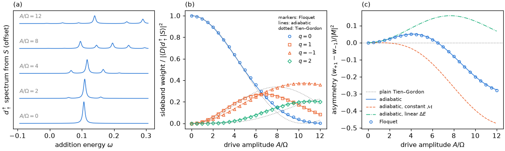

# Tutorial 09: photon-assisted tunnelling into a driven junction

## Goal

Drive the gate of a quantum-dot Josephson junction slowly, $\epsilon(t)=\epsilon_0+A\cos\Omega t$,
and compute what a weak tunnelling contact measures when it adds a spin-up electron to the
singlet ground state $S$ and so creates the doublet $D$:

- the photon sidebands of the tunnelling line, from Floquet states of both parity sectors;
- their weights as functions of $A/\Omega$, compared with the simple Tien–Gordon formula and with
  its adiabatic generalization built from static calculations along the drive;
- the asymmetry between the sidebands $q=+1$ and $q=-1$, and its physical origin.

## Physics in brief

Without a drive the probe $d^\dagger_\uparrow$ produces one line at $E_D-E_S$ with strength
$\lvert\langle D\vert d^\dagger_\uparrow\vert S\rangle\rvert^2$. With the drive, the Floquet golden
rule gives lines at $\varepsilon_D-\varepsilon_S+q\Omega$, where $\varepsilon_S$ and $\varepsilon_D$ are
the quasienergies of the dressed singlet and doublet. In the tunnelling event the junction emits
$q$ photons into the drive ($q>0$, the probe supplies the extra energy) or absorbs $\lvert q\rvert$
photons from it ($q<0$).

For a decoupled dot the states have integer charge, the drive only multiplies them by phases,
and the sideband weights are Bessel functions, $J_q^2(\Delta n A/\Omega)$, where $\Delta n$ is the
charge difference between the final and the initial state (Tien–Gordon). In the junction the
charges are not integers, $n_S\approx0.74$ and $n_D\approx0.97$ here, and both the transition
energy $\Delta E(\epsilon)=E_D-E_S$ and the matrix element
$\mathcal M(\epsilon)=\langle D(\epsilon)\vert d^\dagger_\uparrow\vert S(\epsilon)\rangle$ depend nonlinearly
on the detuning $\epsilon$. For a drive much slower than the excitation gaps inside each parity
sector, the states follow the drive adiabatically and the sideband amplitudes are the Fourier
coefficients of

```math
F(t)=\mathcal M\bigl(\epsilon(t)\bigr)\exp\Bigl[i\int_0^t\bigl(\Delta E(\epsilon(t'))-\overline{\Delta E}\bigr)\,dt'\Bigr]
=\sum_q F_q\,e^{iq\Omega t},
```

with weights $\lvert F_q\rvert^2$ and the $q=0$ line at the period average $\overline{\Delta E}$.
Because $\partial H/\partial\epsilon=n_d-1$, the Hellmann–Feynman theorem gives
$d\Delta E/d\epsilon=n_D-n_S=\Delta n$. Linearizing $\Delta E$ and holding $\mathcal M$ constant therefore reduces the
adiabatic formula to the simple Tien–Gordon expression. By Parseval's theorem the weights summed over $q$
equal the period average of $\lvert\mathcal M\rvert^2$.

$\mathcal M$ must be evaluated in the parallel-transport gauge, where the ground states at neighbouring
detunings have real, positive overlaps. The script checks that $\mathcal M$ then has a constant phase, so
that $\lvert\mathcal M\rvert$ can be used.

## Physics manual

<!-- BEGIN generated: physics-manual (tools/gen_docs.py) -->
The physics behind this tutorial is explained in the
[physics manual](../../docs/manual/README.md):

- chapter “Example: photon-assisted tunnelling into a driven junction” (`ch:ex-pat`)
- chapter “Probing the driven junction” (`ch:probes`)
- chapter “Example: the gate-driven isolated dot” (`ch:ex-dot`)
<!-- END generated: physics-manual -->

## Run

From the repository root, after `python -m pip install '.[plots]'` (matplotlib is needed only
for the figure):

```sh
python -B examples/09_photon_assisted_tunnelling/run.py                  # quick: 5 amplitudes, about 3 s
python -B examples/09_photon_assisted_tunnelling/run.py --profile full   # 25 amplitudes, about 10 s
```

Both profiles use the junction of the physics manual's chapter: $U=1$, $\Gamma=0.5$,
$\epsilon_0=0.2$, $\phi=0.8$, two bath level pairs per lead with half-bandwidth $10$, QP cutoff
$2$ and $\Omega=0.05$, in units of the gap $\Delta=1$. The quick profile uses the amplitudes
$A=0,0.1,\dots,0.4$ (up to $A/\Omega=8$) with the Floquet cutoff $\lceil A/\Omega\rceil+4$ and 24
Chebyshev nodes for the static scan. The full profile uses $A$ from $0$ to $0.6$ in steps of
$0.025$ (up to $A/\Omega=12$), the Floquet cutoff $\lceil A/\Omega\rceil+10$ and 40 nodes. The
numbers reported at $A=0.4$, $A/\Omega=8$, agree between the profiles.

Only the two dressed ground states are needed, so the script follows one Floquet state in each
parity sector, in the full Fock space at QP cutoff 2, with the shift-invert solver. This avoids a
truncated static basis and takes a fraction of a second per amplitude. Results are written to
`runs/examples/09_photon_assisted_tunnelling/<profile>/`: `results.json` with the numbers below,
the lines and the curves, and `photon_assisted_tunnelling.png`.

## Expected results

<!-- BEGIN generated: expected-results (tools/gen_docs.py) -->
`python tools/check_tutorials.py 09_photon_assisted_tunnelling` runs the quick profile and compares it with
[`reference/quick.json`](reference/quick.json); add `--profile full` for
[`reference/full.json`](reference/full.json).

| Quantity | Key | Quick profile | Full profile | Tolerance |
|---|---|---|---|---|
| Singlet charge $n_S=\langle S\vert n_d\vert S\rangle$ | `n_S` | 0.739744 | 0.739744 | ±1e-09 |
| Doublet charge $n_D=\langle D\vert n_d\vert D\rangle$ | `n_D` | 0.970385 | 0.970385 | ±1e-09 |
| Charge difference $\Delta n=n_D-n_S$ | `dn` | 0.230641 | 0.230641 | ±1e-09 |
| Undriven tunnelling line $E_D-E_S$ | `excitation` | 0.106319 | 0.106319 | ±1e-09 |
| Static strength $\lvert\langle D\vert d^\dagger_\uparrow\vert S\rangle\rvert^2$ | `static_strength` | 0.475076 | 0.475076 | ±1e-09 |
| Excitation gap of the singlets $E_{S^*}-E_S$ | `gap_singlets` | 0.7310 | 0.7310 | ±1e-09 |
| Excitation gap above the doublet | `gap_doublet` | 1.3126 | 1.3126 | ±1e-09 |
| Slope $d\Delta E/d\epsilon$ minus $\Delta n$ (Hellmann–Feynman) | `hellmann_feynman` | at most 1e-08 | at most 1e-08 | upper bound |
| Error of the Chebyshev interpolants at $\epsilon_0$ | `interpolation` | at most 1e-08 | at most 1e-08 | upper bound |
| Phase change of $\mathcal M(\epsilon)$ in the parallel-transport gauge | `element_phase` | at most 1e-08 | at most 1e-08 | upper bound |
| Smallest $\Delta E$ over the drive at $A/\Omega=8$ | `gap_min` | 0.0826 | 0.0826 | ±1e-08 |
| Largest $\Delta E$ over the drive at $A/\Omega=8$ | `gap_max` | 0.2604 | 0.2604 | ±1e-08 |
| Smallest $\lvert\mathcal M\rvert$ over the drive at $A/\Omega=8$ | `element_min` | 0.4809 | 0.4809 | ±1e-08 |
| Largest $\lvert\mathcal M\rvert$ over the drive at $A/\Omega=8$ | `element_max` | 0.7820 | 0.7820 | ±1e-08 |
| Floquet weight $w_{-1}$ at $A/\Omega=8$, in units of the static strength | `weight_minus` | 0.3319 | 0.3319 | ±1e-06 |
| Floquet weight $w_0$ at $A/\Omega=8$, in units of the static strength | `weight_zero` | 0.1509 | 0.1509 | ±1e-06 |
| Floquet weight $w_{+1}$ at $A/\Omega=8$, in units of the static strength | `weight_plus` | 0.2511 | 0.2511 | ±1e-06 |
| Floquet asymmetry $w_{+1}-w_{-1}$ at $A/\Omega=8$ | `asymmetry` | -0.0808 | -0.0808 | ±1e-06 |
| Adiabatic asymmetry at $A/\Omega=8$ | `asymmetry_adiabatic` | -0.0809 | -0.0809 | ±1e-08 |
| Adiabatic asymmetry with constant $\mathcal M$ at $A/\Omega=8$ | `asymmetry_constant_element` | -0.2620 | -0.2620 | ±1e-08 |
| Adiabatic asymmetry with linearized $\Delta E$ at $A/\Omega=8$ | `asymmetry_linear_gap` | 0.1572 | 0.1572 | ±1e-08 |
| Simple Tien–Gordon weight $J_0^2(\Delta n A/\Omega)$ at $A/\Omega=8$ | `tien_gordon_zero` | 0.0984 | 0.0984 | ±1e-10 |
| Simple Tien–Gordon weight $J_1^2(\Delta n A/\Omega)$ of $q=\pm1$ at $A/\Omega=8$ | `tien_gordon_one` | 0.3386 | 0.3386 | ±1e-10 |
| Adiabatic formula with linear $\Delta E$ and constant $\mathcal M$ minus $J_q^2(\Delta n A/\Omega)$ | `tien_gordon_check` | at most 1e-10 | at most 1e-10 | upper bound |
| Floquet $q=0$ line $\varepsilon_D-\varepsilon_S$ at $A/\Omega=8$ | `line_center` | 0.14558 | 0.14558 | ±1e-08 |
| Period average $\overline{\Delta E}$ at $A/\Omega=8$ | `line_center_adiabatic` | 0.14541 | 0.14541 | ±1e-08 |
| Floquet weight summed over $q$ at $A/\Omega=8$, in units of the static strength | `total_weight` | 0.9383 | 0.9383 | ±1e-06 |
| Period average of $\lvert\mathcal M\rvert^2$ at $A/\Omega=8$, in units of the static strength | `total_weight_adiabatic` | 0.9385 | 0.9385 | ±1e-08 |
| Largest difference of Floquet and adiabatic weights, $\lvert q\rvert\le3$ | `max_deviation_adiabatic` | at most 1e-02 | at most 1e-02 | upper bound |
| Largest Floquet residual bound | `residual` | at most 1e-05 | at most 1e-05 | upper bound |
<!-- END generated: expected-results -->

The full profile gives this figure. Panels (a) and (b) correspond to the figure of the physics
manual's chapter; panel (c) analyses the origin of the asymmetry:



## What to look at

- **Panel (a).** The single tunnelling line splits into sidebands spaced by $\Omega$ as the
  amplitude grows. The entire set of sidebands also shifts upwards: at $A/\Omega=8$ the $q=0$ line lies at
  $0.1456$ instead of $E_D-E_S=0.1063$. $\Delta E(\epsilon)$ is convex, with its minimum at half
  filling, $\epsilon=0$, so its period average exceeds $\Delta E(\epsilon_0)$; the adiabatic estimate
  $\overline{\Delta E}=0.1454$ accounts for the shift.
- **Panel (b).** The Floquet weights (markers) follow the adiabatic formula (lines) to better than
  $0.01$ over the whole range, while the simple Tien–Gordon formula (dotted) only reproduces the envelope. At
  $A/\Omega=8$ it predicts $0.339$ for both $q=\pm1$ and $0.098$ for $q=0$; the Floquet weights are
  $0.332$ for $q=-1$, $0.251$ for $q=+1$ and $0.151$ for $q=0$. Over the drive at this amplitude,
  $\Delta E$ varies from $0.083$ to $0.260$ and $\lvert\mathcal M\rvert$ from $0.48$ to $0.78$.
- **Panel (c).** The simple Tien–Gordon formula is symmetric under $q\to-q$. The Floquet asymmetry
  $w_{+1}-w_{-1}$ is positive at small amplitude, changes sign near $A/\Omega=6.5$ and reaches
  $-0.28$ at $A/\Omega=12$. Evaluating the adiabatic formula with a constant $\mathcal M$ (dashed) or with a
  linearized $\Delta E$ (dash-dotted) shows that the two dependences produce asymmetries of
  opposite sign; the observed asymmetry is their net effect.
- **Sum rule.** At $A/\Omega=8$ the sidebands into the dressed doublet carry $0.938$ of the static
  strength, in agreement with the period average of $\lvert\mathcal M\rvert^2$. The rest of the weight of
  $d^\dagger_\uparrow\vert S\rangle$ goes into excited odd states, which this calculation does not
  follow.
- **Beyond the adiabatic limit.** The remaining differences, below $0.01$, are non-adiabatic
  corrections. They grow as $\Omega$ approaches the internal gaps ($0.73$ for the singlets, $1.31$
  above the doublet), as the suggestion to raise `OMEGA` below shows.

## Try next

- Set `detuning=0.` in `JUNCTION`. At half filling $n_S=n_D=1$, so the simple Tien–Gordon formula predicts
  no sidebands at all, but $\Delta E(\epsilon)$ is quadratic and $\mathcal M(\epsilon)$ varies, and the
  Floquet spectrum still shows them.
- Raise `OMEGA` towards the internal gaps, for example to $0.2$. The adiabatic formula then
  misses the Floquet weights by up to $0.25$ in the quick profile, while the Floquet
  calculation needs no adiabatic assumption.
- Replace `"d_up_dagger"` by `"d_dn"`, which removes a spin-down electron from $S$ and also
  reaches the spin-up doublet. The removal amplitude decreases with $\epsilon$ where the addition
  amplitude increases, so both dependences now contribute to the asymmetry with the same sign, and it reaches
  about $-0.57$ at $A/\Omega=8$.
- Set `PAIRS = 4` to check the bath convergence of the charges, of $\Delta E$ and of the weights
  (about 11 s for the quick profile).

## Files

| File | Content |
|---|---|
| [`run.py`](run.py) | The calculation: static junction, Floquet sidebands, adiabatic and Tien–Gordon weights, and the figure |
| [`reference/quick.json`](reference/quick.json), [`reference/full.json`](reference/full.json) | Expected values and tolerances |
| [`expected.png`](expected.png) | Figure of the full profile |

The script uses `PeriodicHamiltonian.from_parameters` with a `ParameterDrive` of the detuning,
`solve_floquet` with one tracked state per parity sector, `FloquetStates.matrix_elements` across
the two sectors for the probe $d^\dagger_\uparrow$, and `FloquetTransitions.lines` out of
`dressed_state(0)` of the singlet. The adiabatic formula uses static `solve` results on Chebyshev
nodes, `Eigenstates.matrix_elements` and `Eigenstates.overlaps`.

## See also

- [Floquet calculations](../../docs/floquet.md): drives, methods, and
  [transitions and spectra](../../docs/floquet.md#transitions-and-spectra)
- [Option reference](../../docs/reference/options.md#floquet-calculations),
  [result reference](../../docs/reference/results.md#probe-matrix-elements) and
  [probes](../../docs/reference/observables.md#probes)
- [Physical models and conventions](../../docs/models.md): the reference junction and the detuning
- The [tutorial index](../README.md)
