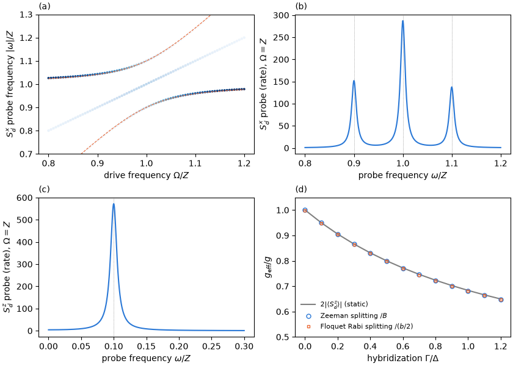

# Tutorial 10: electron spin resonance of the doublet

## Goal

Split the doublet $D$ of a quantum-dot Josephson junction with a static Zeeman field, drive spin
flips with a transverse AC field, and quantify the reduction of the local spin response due to
screening by the superconducting leads:

- the effective $g$-factor from the static spin polarization, from the Zeeman splitting and from
  the Floquet Rabi splitting at resonance;
- the Bloch–Siegert shift of the resonance, caused by the counter-rotating part of the drive;
- what weak probes of the driven spin measure: the Mollow pattern of a transverse probe $S^x_d$ and
  a line at the Rabi frequency in a longitudinal probe $S^z_d$;
- the reduction of $g_{\mathrm{eff}}/g$ with increasing hybridization $\Gamma$.

## Physics in brief

The dot carries a static Zeeman energy and a transverse drive,

```math
H_d(t)=\frac U2(n_d-1)^2+\epsilon(n_d-1)+B\,S^z_d+b\cos(\Omega t)\,S^x_d,\qquad
S^x_d=\tfrac12\bigl(d^\dagger_\uparrow d_\downarrow+d^\dagger_\downarrow d_\uparrow\bigr).
```

The field acts on the dot only. $B$ splits the doublet into $D_\downarrow$ (lower) and $D_\uparrow$,
separated by the Zeeman splitting $Z$. The transverse term does not conserve $S_z$, so the
calculation uses the odd sector with all spin projections, `Sector(1, None)`.

In the junction the doublet is a correlated state of the dot spin and the leads. Within the
doublet the impurity spin is proportional to the total spin, $\mathbf S_d=(g_{\mathrm{eff}}/g)\mathbf S$
(Wigner–Eckart theorem), with
$g_{\mathrm{eff}}/g=2\lvert\langle D_\downarrow\vert S^z_d\vert D_\downarrow\rangle\rvert\le1$. The
relation is exact at zero field. In a field the polarizations of the two Zeeman levels differ at
linear order in $B$; the script quotes that of the lower level. Both the Zeeman and the Rabi
splitting are renormalized by this factor:

```math
Z\simeq\frac{g_{\mathrm{eff}}}{g}\,B,\qquad
\delta=b\,\bigl\lvert\langle D_\uparrow\vert S^x_d\vert D_\downarrow\rangle\bigr\rvert=\frac{g_{\mathrm{eff}}}{g}\,\frac b2 .
```

Near resonance the two dressed doublet states are split, in the rotating frame, by
$w=\sqrt{(\Omega-\Omega_r)^2+\delta^2}$. The script obtains $\delta$ and the resonance frequency
$\Omega_r$ by fitting $w^2$ to a parabola in $\Omega$. The counter-rotating part of the linearly
polarized drive shifts the resonance from $Z$ to $\Omega_r\approx Z+\delta^2/4Z$ (Bloch–Siegert).

A weak transverse probe $S^x_d$, with the system initially in the dressed lower Zeeman level, acts on the driven
transition itself and shows the Mollow pattern: stimulated emission at $-(\Omega-\delta)$,
absorption at $\Omega+\delta$ and elastic lines at $\pm\Omega$. In the rotating-wave approximation
(RWA) each line carries
$\lvert\langle D_\uparrow\vert S^x_d\vert D_\downarrow\rangle\rvert^2/4=(g_{\mathrm{eff}}/g)^2/16$.
A weak longitudinal probe $S^z_d$, a modulation of the static field, connects the two dressed
states. It gives a single line at the Rabi frequency $\delta$ with strength
$(g_{\mathrm{eff}}/g)^2/4$, which measures the effective $g$-factor through a matrix element.

## Physics manual

<!-- BEGIN generated: physics-manual (tools/gen_docs.py) -->
The physics behind this tutorial is explained in the
[physics manual](../../docs/manual/README.md):

- chapter “Example: electron spin resonance of the doublet” (`ch:ex-esr`)
- section “Probing the driven spin” (`sec:esr-probe`)
- section “Mollow triplet and Autler–Townes doublet” (`sec:mollow`)
<!-- END generated: physics-manual -->

## Run

From the repository root, after `python -m pip install '.[plots]'` (matplotlib is needed only
for the figure):

```sh
python -B examples/10_spin_resonance/run.py                  # quick: 5 drive frequencies, 3 couplings, about 7 s
python -B examples/10_spin_resonance/run.py --profile full   # 81 drive frequencies, 13 couplings, about 40 s
```

Both profiles use the junction of the physics manual's ESR chapter: $U=1$, $\epsilon=0$,
$\phi=0.8$, $\Gamma=0.3$, four bath level pairs per lead with half-bandwidth $10$, QP cutoff $2$,
$B=0.02$ and $b=0.004$, in units of the gap $\Delta=1$. The Floquet calculations use the Floquet
cutoff $M=8$ and a static basis of the $K=24$ lowest states. The profiles differ only in the
number of drive frequencies of the probe sweep (panel (a)) and in the couplings of the
$g$-factor scan ($\Gamma=0,0.3,1.2$ in the quick profile, $\Gamma$ from $0$ to $1.2$ in steps of
$0.1$ in the full profile), so all other numbers agree between the profiles. Most of the time
goes into the dense static diagonalization of the odd sector, one per $\Gamma$.

The drive is sampled once per $\Gamma$; for other frequencies the script only replaces $\Omega$,
because the harmonics of a drive $p_0+A\cos\Omega t$ do not depend on $\Omega$. Results are written
to `runs/examples/10_spin_resonance/<profile>/`: `results.json` with the numbers below, the lines
and the scan, and `spin_resonance.png`.

## Expected results

<!-- BEGIN generated: expected-results (tools/gen_docs.py) -->
`python tools/check_tutorials.py 10_spin_resonance` runs the quick profile and compares it with
[`reference/quick.json`](reference/quick.json); add `--profile full` for
[`reference/full.json`](reference/full.json).

| Quantity | Key | Quick profile | Full profile | Tolerance |
|---|---|---|---|---|
| Zeeman splitting $Z=E_{D_\uparrow}-E_{D_\downarrow}$ | `zeeman` | 0.017303 | 0.017303 | ±1e-09 |
| $g_{\mathrm{eff}}/g=2\lvert\langle S^z_d\rangle\rvert$ in the lower Zeeman level | `geff` | 0.866122 | 0.866122 | ±1e-09 |
| $g_{\mathrm{eff}}/g$ from the Zeeman splitting, $Z/B$ | `geff_zeeman` | 0.865150 | 0.865150 | ±1e-09 |
| $g_{\mathrm{eff}}/g=2\lvert\langle D_\downarrow\vert S^x_d\vert D_\uparrow\rangle\rvert$ | `geff_transverse` | 0.865146 | 0.865146 | ±1e-09 |
| RWA Rabi splitting $b\lvert\langle D_\uparrow\vert S^x_d\vert D_\downarrow\rangle\rvert$ | `rabi_rwa` | 0.0017303 | 0.0017303 | ±1e-10 |
| Floquet Rabi splitting $\delta$ at resonance | `rabi` | 0.0017292 | 0.0017292 | ±1e-09 |
| $g_{\mathrm{eff}}/g$ from the Rabi splitting, $\delta/(b/2)$ | `geff_rabi` | 0.864605 | 0.864605 | ±1e-06 |
| Relative reduction of $\delta$ below the RWA value | `rabi_reduction` | 6.26e-04 | 6.26e-04 | ±1e-06 |
| Curvature of $w^2(\Omega)$ near resonance (1 in the RWA) | `curvature` | 1.0025 | 1.0025 | ±1e-05 |
| Bloch–Siegert shift of the resonance, $\Omega_r-Z$ | `bloch_siegert` | 4.316e-05 | 4.316e-05 | ±1e-09 |
| Estimate $\delta^2/4Z$ of the Bloch–Siegert shift | `bloch_siegert_estimate` | 4.320e-05 | 4.320e-05 | ±1e-10 |
| $S^x_d$ emission sideband at $-(Z-\delta)$, for $\Omega=Z$ | `sx_lower` | 0.04921 | 0.04921 | ±1e-06 |
| $S^x_d$ elastic line at $\pm Z$ (each), for $\Omega=Z$ | `sx_elastic` | 0.04670 | 0.04670 | ±1e-06 |
| $S^x_d$ absorption sideband at $Z+\delta$, for $\Omega=Z$ | `sx_upper` | 0.04452 | 0.04452 | ±1e-06 |
| RWA strength of each $S^x_d$ line, $\lvert\langle D_\uparrow\vert S^x_d\vert D_\downarrow\rangle\rvert^2/4$ | `sx_rwa` | 0.04678 | 0.04678 | ±1e-09 |
| $S^x_d$ sideband asymmetry, (absorption $-$ emission)/(sum), for $\Omega=Z$ | `sx_asymmetry` | -0.0500 | -0.0500 | ±1e-06 |
| Ratio $\delta/Z$ | `rabi_over_zeeman` | 0.09994 | 0.09994 | ±1e-07 |
| $S^z_d$ line frequency for $\Omega=Z$ | `sz_frequency` | 0.0017297 | 0.0017297 | ±1e-09 |
| $S^z_d$ line strength for $\Omega=Z$ | `sz_line` | 0.18653 | 0.18653 | ±1e-06 |
| RWA strength of the $S^z_d$ line, $\lvert\langle D_\uparrow\vert S^x_d\vert D_\downarrow\rangle\rvert^2=(g_{\mathrm{eff}}/g)^2/4$ | `sz_rwa` | 0.18712 | 0.18712 | ±1e-09 |
| $g_{\mathrm{eff}}/g=2\lvert\langle S^z_d\rangle\rvert$ at $\Gamma=1.2$ | `geff_last` | 0.6495 | 0.6495 | ±1e-09 |
| Largest spread of the three determinations of $g_{\mathrm{eff}}/g$ over $\Gamma$ | `geff_spread` | at most 3e-03 | at most 3e-03 | upper bound |
| Fock-space residual of the dressed doublet in the static basis | `fock_residual` | at most 1e-03 | at most 1e-03 | upper bound |
<!-- END generated: expected-results -->

The full profile gives this figure. Panels (a) to (c) correspond to the physics manual's figure
on probing the driven spin, panel (d) to the $g$-factor scan of its ESR chapter:



## What to look at

- **Effective g-factor.** At $\Gamma=0.3$ the spin polarization of the lower Zeeman level gives
  $g_{\mathrm{eff}}/g=0.8661$, while $Z/B$ and
  $2\lvert\langle D_\downarrow\vert S^x_d\vert D_\uparrow\rangle\rvert$ both give $0.8651$ and
  agree with each other to $4\times10^{-6}$. The difference of $10^{-3}$ comes from the linear
  change of the polarization with $B$: the upper level has $0.8642$, and the mean of the two
  levels, $0.8651$, equals the zero-field value to first order in $B$.
- **Rabi splitting.** The Floquet splitting $\delta=0.0017292$ is smaller than the RWA value
  $b\lvert\langle D_\uparrow\vert S^x_d\vert D_\downarrow\rangle\rvert=0.0017303$ by the fraction
  $6.3\times10^{-4}\approx(\delta/Z)^2/16$, and the resonance is shifted by
  $\Omega_r-Z=4.32\times10^{-5}\approx\delta^2/4Z$. Both are effects of the counter-rotating term.
- **Panel (a).** The lines of the transverse probe avoid each other at resonance and follow the
  RWA prediction $\Omega\pm w$ (dashed). The faint diagonal is the elastic line at
  $\lvert\omega\rvert=\Omega$.
- **Panel (b).** At $\Omega=Z$ the four lines of the Mollow pattern have strengths $0.0492$
  (emission at $-(Z-\delta)$), $0.0445$ (absorption at $Z+\delta$) and $0.0467$ (each elastic
  line), close to the RWA value $0.0468$. The two sidebands differ by about 10%, an effect of order
  $\delta/Z=0.1$ beyond the RWA; halving $b$ halves it.
- **Panel (c).** The longitudinal probe shows one line at the Rabi frequency, with strength
  $0.1865$ against the RWA value $0.1871$.
- **Panel (d).** The three determinations of $g_{\mathrm{eff}}/g$ fall from $1$ at $\Gamma=0$ to
  $0.65$ at $\Gamma=1.2$, the impurity Knight shift. They agree to $2\times10^{-3}$, the size of the
  finite-field and counter-rotating corrections above.

## Try next

- Halve `DRIVE`. The Rabi splitting and the sideband asymmetry halve, while the resonance shift and
  the relative reduction of $\delta$ drop by a factor of four.
- Halve `FIELD` together with `DRIVE`. The difference between the polarization of the lower level
  and $Z/B$ halves.
- Change the default `phi` of `esr_model` to `np.pi`. The stronger screening at phase $\pi$ lowers
  $g_{\mathrm{eff}}/g$ to $0.853$ at $\Gamma=0.3$ and to $0.611$ at $\Gamma=1.2$.
- Move away from half filling with the `detuning` of `esr_model`, or increase `BASIS` and
  `HARMONICS`, and check which numbers change.

## Files

| File | Content |
|---|---|
| [`run.py`](run.py) | The calculation: model with a transverse field, static doublet, Floquet Rabi splitting, probes and the figure |
| [`reference/quick.json`](reference/quick.json), [`reference/full.json`](reference/full.json) | Expected values and tolerances |
| [`expected.png`](expected.png) | Figure of the full profile |

The built-in `reference_model` has no transverse field, so the script builds the junction with
`make_model` and an `Impurity` whose operator adds $b S^x_d$ (`hermitian_pair(X)` is $X+X^\dagger$):

<!-- docs-test: setup import numpy as np; from qdjj_solver import Impurity, annihilate, cosh_grid, create, hermitian_pair, make_model; GAMMA, FIELD = .3, .02 -->

```python
def esr_model(transverse=0., gamma=GAMMA, u=1., detuning=0., field=FIELD, phi=.8, pairs=4, bandwidth=10.):
    bath = cosh_grid(pairs=pairs, delta=1., bandwidth=bandwidth)
    anderson = Impurity.anderson(u, detuning, field)
    operator = anderson.operator + hermitian_pair(.5*transverse*create(0)*annihilate(1))
    impurity = Impurity(1, operator, metadata=dict(kind="anderson-transverse"))
    hopping = np.sqrt(gamma/(np.pi*bath.rho*2))*np.eye(2)
    return make_model(impurity, [bath, bath], [hopping, hopping], phases=[-phi/2, phi/2],
                      phase_velocities=[-.5, .5])
```

<!-- docs-test: setup esr_model(transverse=.004) -->

`PeriodicHamiltonian.from_parameters` then drives the parameter `transverse`, and `solve_floquet`
with `selection="all"` in the static eigenbasis gives all Floquet states of the odd sector.
`FloquetStates.matrix_elements` with the probes `"spin_x"` and `"spin_z"` and
`FloquetTransitions.lines` out of `dressed_state(0)` give the probe lines.

## See also

- [Floquet calculations](../../docs/floquet.md): drives, the rotating-wave model, and
  [transitions and spectra](../../docs/floquet.md#transitions-and-spectra)
- [General impurities](../../docs/models.md#general-impurities-and-finite-geometries) and
  [model constructors](../../docs/models.md#model-constructors)
- [Option reference](../../docs/reference/options.md#floquet-calculations),
  [result reference](../../docs/reference/results.md#probe-matrix-elements) and
  [probes](../../docs/reference/observables.md#probes)
- The [tutorial index](../README.md)
