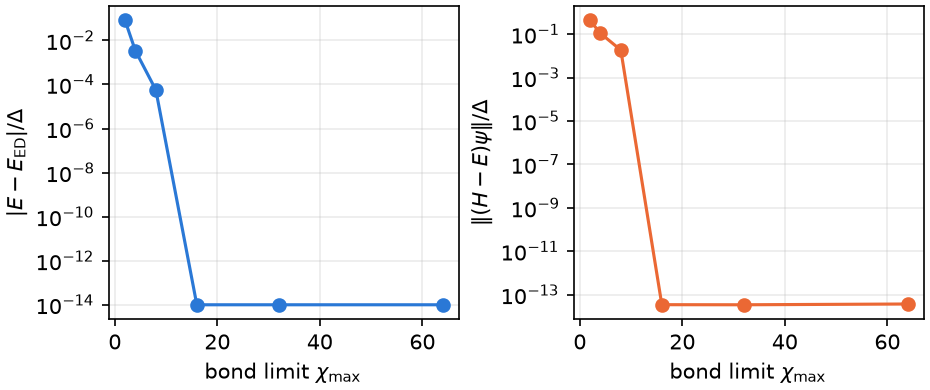

# Tutorial 11: DMRG bond-dimension convergence

## Goal

Refine an odd-parity state of a small junction by increasing the MPS bond dimension,
inspect convergence diagnostics, compare with unrestricted ED for the same bath, and continue from a saved MPS.

## Physics in brief

The finite junction has one mirrored bath pair per lead, gap one, half-bandwidth
five, total hybridization 0.3, interaction 1.6, phase 0.8 and zero detuning/field.
All modes are retained. This is a finite-Hamiltonian check, not a continuum
reference. The selected sector is odd parity with total spin projection 1/2.

## Physics manual

<!-- BEGIN generated: physics-manual (tools/gen_docs.py) -->
The physics behind this tutorial is explained in the
[physics manual](../../docs/manual/README.md):

- chapter “From a Hamiltonian to a checked calculation” (`ch:practical`)
- section “Density-matrix renormalization group” (`sec:dmrg`)
<!-- END generated: physics-manual -->

## Run

Install `.[dmrg,plots]` from the source root, then run:

```sh
python -B examples/11_dmrg_convergence/run.py --output runs/dmrg-ladder
python -B examples/11_dmrg_convergence/run.py --profile full --output runs/dmrg-ladder-full
```

The quick profile uses bond dimensions 2, 4, 16, 32; the full profile adds 8 and 64 and requires two
stable refinement steps. The script resolves its inputs independently of the
working directory. Each completed step is archived immediately.

## Expected results

<!-- BEGIN generated: expected-results (tools/gen_docs.py) -->
`python tools/check_tutorials.py 11_dmrg_convergence` runs the quick profile and compares it with
[`reference/quick.json`](reference/quick.json); add `--profile full` for
[`reference/full.json`](reference/full.json).

| Quantity | Key | Quick profile | Full profile | Tolerance |
|---|---|---|---|---|
| Final odd-sector energy, checked against ED for the same bath | `energy` | -0.296312491144 | -0.296312491144 | ±1e-09 |
| Final energy discrepancy from unrestricted ED | `ed_error` | at most 1e-09 | at most 1e-09 | upper bound |
| Final full finite-Hamiltonian residual | `residual` | at most 1e-07 | at most 1e-07 | upper bound |
| Energy change after save/load and continuation | `continuation_error` | at most 1e-09 | at most 1e-09 | upper bound |
| Empirical bond-dimension convergence criteria satisfied | `empirical_convergence` | 1 | 1 | exact |
<!-- END generated: expected-results -->



Errors below 1e-14 are plotted at that lower limit; this does not establish accuracy at that precision.

## What to look at

The smallest bond-dimension limit deliberately returns an unconverged
state. Its larger residual and ED discrepancy distinguish it from the final
state. A small change in energy is not itself a residual check. After each refinement step, the callback function
records the achieved bond dimensions, charge, overlap error and convergence flags.

## Try next

Request two states and inspect the full overlap matrix; then vary the bath at
a fixed bond dimension for which convergence has been established. Changing the bath generally changes canonical
coordinates and prevents direct continuation of the MPS.

## Files

- `run.py`: calculation, ED comparison, save/load continuation and plot.
- `reference/quick.json`, `reference/full.json`: checked values and tolerances.
- `expected.png`: full-profile figure.
- Fresh output contains `history.json`, `results.json`, `state.json`, its named
  HDF5 companion, and `convergence.png`.

## See also

- [DMRG workflow](../../docs/dmrg.md)
- [Numerical diagnostics](../../docs/numerics.md#residuals-and-convergence-checks)
